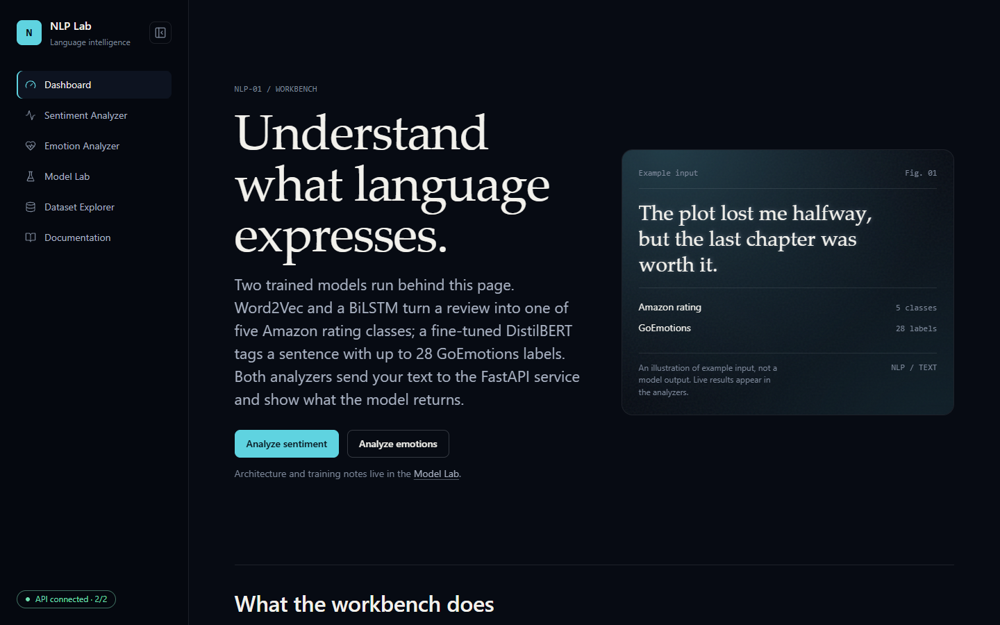
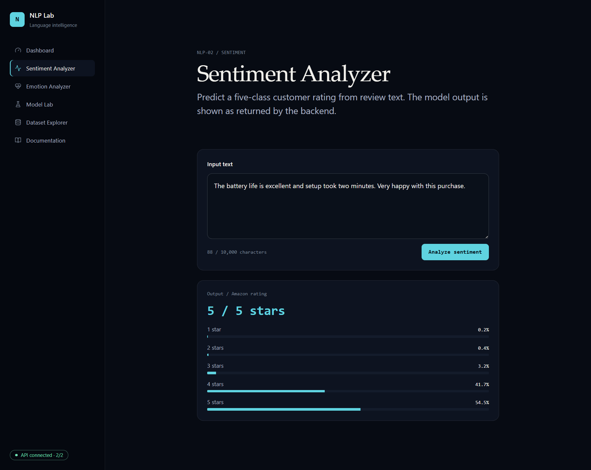
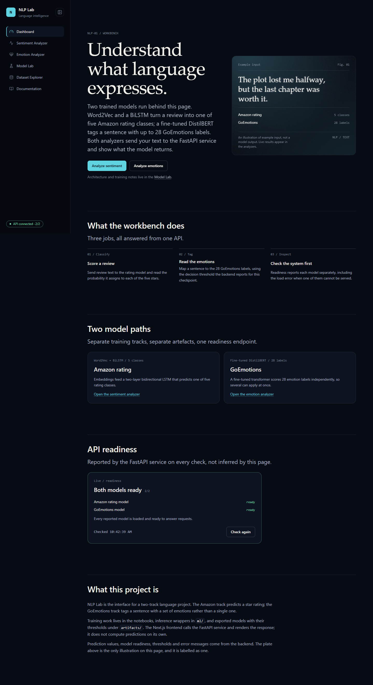
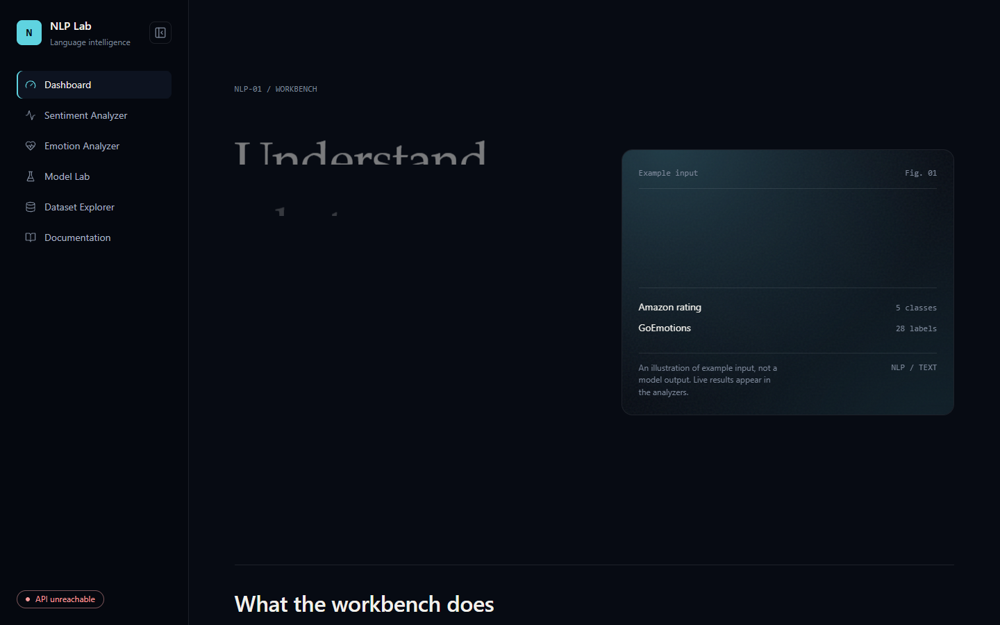
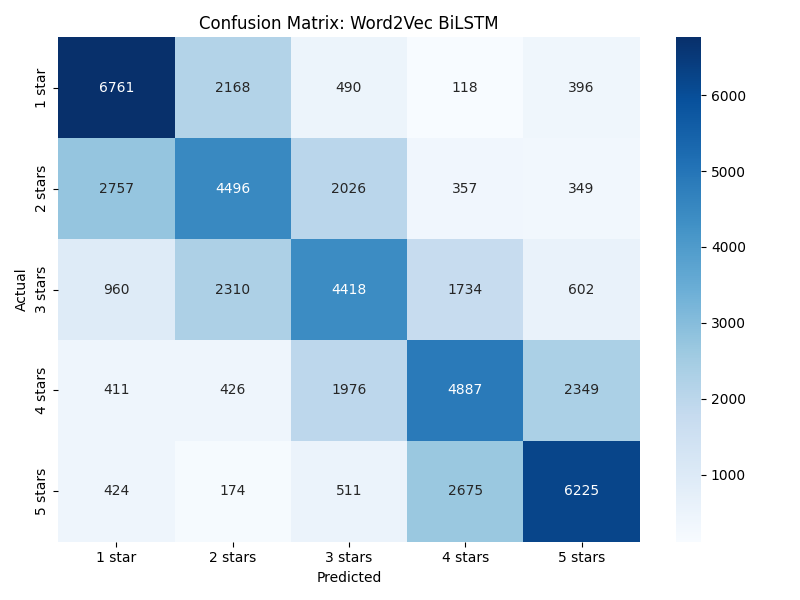
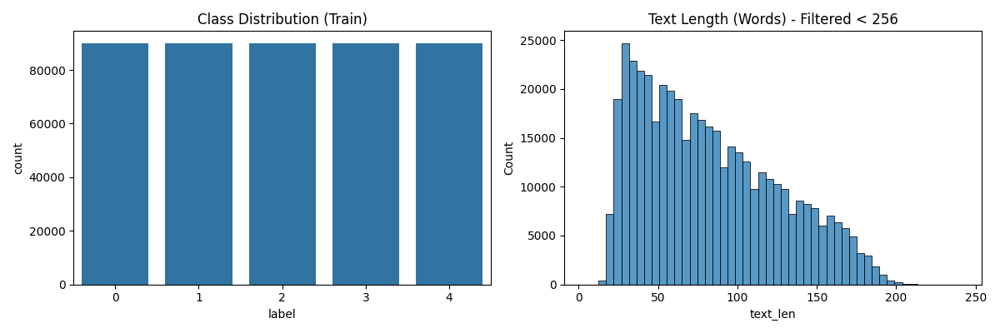
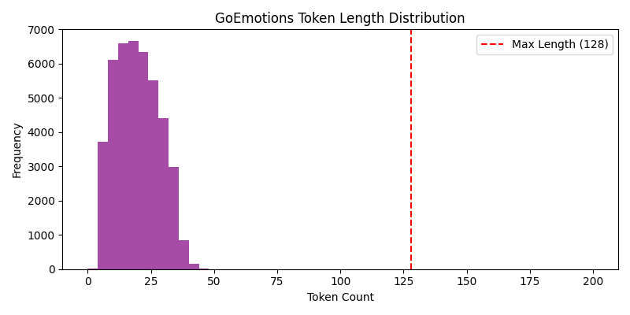

<div align="center">



<br/>
<br/>

# 🧠 NLP Lab — Two Models, One Endpoint

**Built by [Akshay Yadav](https://github.com/Akshay-2312) · [Two_Models_One_EndPoint](https://github.com/Akshay-2312/Two_Models_One_EndPoint)**


</div>

<div align="center">

## 🔬 Two Architectures · 33 Classes &amp; Labels · One Honest Inference Contract

</div>

> **Real weights, real readiness, zero synthetic fallbacks.** NLP Lab serves two distinct text-classification pipelines behind a single FastAPI service on `:8000` and a Next.js 14 Pages Router workbench on `:3000`. If trained checkpoints are missing on disk, `/readiness` reports `not_ready` and prediction endpoints fail honestly with HTTP `503` (`model_not_ready`) — never fabricated outputs.
>
> **Track A** pairs a custom 200-d Word2Vec Skip-gram embedding matrix with a 2-layer Bidirectional LSTM (**16,734,869** parameters) trained on 450,000 stratified Amazon reviews (`1–5` stars). **Track B** fine-tunes `distilbert-base-uncased` (**66,975,004** parameters) with independent sigmoid heads calibrated at threshold `0.30` across **28 GoEmotions labels** (27 emotions + `neutral`) on 54,263 Reddit comments.


> Full training methodology, dataset quality audits, and checkpoint provenance live in **[`reports/research_report.md`](reports/research_report.md)**, **[`data/dataset_explorer_summary.json`](data/dataset_explorer_summary.json)**, and **[`data/model_lab_artifacts.json`](data/model_lab_artifacts.json)**.
>
> <sub>Live FastAPI prediction routes execute PyTorch directly on `MODEL_DEVICE` (`cpu` by default); ONNX Runtime (`opset_version=17`, `CPUExecutionProvider`) is exported and verified offline against PyTorch within `1e-4` tolerance (`1.19e-07` for Amazon BiLSTM, `3.34e-06` for GoEmotions DistilBERT).</sub>

<br/>

<div align="center">

<h3>

⭐ Star the repo if NLP Lab helped you build or inspect dual-model NLP serving.

</h3>

[](https://github.com/Akshay-2312/Two_Models_One_EndPoint)
[](LICENSE)
[](configs/requirement.txt)
[](backend/app/main.py)
[](frontend/package.json)
[](ml/amazon_rating/inference.py)

### 🧭 Explore the Project

[](https://github.com/Akshay-2312)
[](https://github.com/Akshay-2312/Two_Models_One_EndPoint)
[](docs/openapi.json)
[](reports/research_report.md)
[](https://github.com/Akshay-2312/Two_Models_One_EndPoint/issues)

**Jump to → [Research Report](reports/research_report.md) · [Design System](frontend/DESIGN_SYSTEM.md) · [OpenAPI Schema](docs/openapi.json) · [Dataset Audit](data/dataset_explorer_summary.json) · [Technology Manifest](data/technology_manifest.json)**

<br/>

## 📈 Workbench Evolution

<div align="center">

|                                 | Phase 01 Foundation | **Phase 02 UI &amp; Governance** |    Current `main`    |
| ------------------------------- | :-----------------: | :------------------------------: | :------------------: |
| 🧠 Dual PyTorch Inference API   |          ✓          |                ✓                 |          ✓           |
| 📡 Real `/readiness` Probing    |          ✓          |                ✓                 |          ✓           |
| 🎨 Tokenized Dark Design System |   🆕 `tokens.css`   |                ✓                 |          ✓           |
| 🚪 Entry Gate &amp; Collapsible Rail |         —          |        🆕 `EntryPreloader`       |          ✓           |
| 🧪 Model Lab &amp; Dataset Explorer |         —          |       🆕 governed views          |          ✓           |
| 🐳 Full-Stack Docker Compose    |   Backend only      |                —                 | 🆕 `frontend/Dockerfile` |
| 🔍 Technology Stack Audit Route |          —          |                —                 |  🆕 `/technology`    |
| 🎭 3-Job CI + Playwright Smoke  |      Unit checks    |         Visual QA shots          |  🆕 automated gate   |

**→ Progress logs: [`PHASE_01_PROGRESS.md`](reports/PHASE_01_PROGRESS.md) · [`PHASE_02_PROGRESS.md`](reports/PHASE_02_PROGRESS.md)**

</div>

<br/>

## 🧩 Available

[](docs/openapi.json)
[](frontend/pages/index.tsx)
[](docker-compose.yml)
[](.github/workflows/ci.yml)
[](LICENSE)

<table>
  <tr>
    <td align="right"><b>🚀 Start</b></td>
    <td align="center"><a href="#quick-start">🚀 Quick Start</a></td>
    <td align="center"><a href="#first-run">🧪 First-Run Verify</a></td>
    <td align="center"><a href="#repo-structure">🗂️ Repo Structure</a></td>
  </tr>
  <tr>
    <td align="right"><b>💡 Models</b></td>
    <td align="center"><a href="#the-promise">🎯 The Promise</a></td>
    <td align="center"><a href="#why-nlp-lab">💡 Why NLP Lab</a></td>
    <td align="center"><a href="#serving-resilience">⚡ Serving &amp; Benchmarks</a></td>
  </tr>
  <tr>
    <td align="right"><b>⚙️ Explore</b></td>
    <td align="center"><a href="#ml-stack">🧠 ML &amp; Web Stack</a></td>
    <td align="center"><a href="#tech-stack">🧱 Tech Matrix</a></td>
    <td align="center"><a href="#documentation">📖 Documentation</a></td>
  </tr>
  <tr>
    <td align="right"><b>👀 See it</b></td>
    <td align="center"><a href="#ui-showcase">🖼️ UI States &amp; Plots</a></td>
    <td align="center"><a href="#serving-resilience">📊 Per-Class Metrics</a></td>
    <td align="center"><a href="#privacy-local">🔒 Local &amp; Governance</a></td>
  </tr>
  <tr>
    <td align="right"><b>🧪 Verify</b></td>
    <td align="center"><a href="#cli-ci">💻 Checks &amp; CI</a></td>
    <td align="center"><a href="#serving-resilience">🔌 11 API Endpoints</a></td>
    <td align="center"><a href="#quick-start">🐳 Docker Compose</a></td>
  </tr>
  <tr>
    <td align="right"><b>📦 Project</b></td>
    <td align="center"><a href="reports/research_report.md">📄 Research Report</a></td>
    <td align="center"><a href="frontend/DESIGN_SYSTEM.md">🎨 Design System</a></td>
    <td align="center"><a href="LICENSE">📜 MIT License</a></td>
  </tr>
</table>

</div>

<br/>
<br/>

<div align="center">

<a id="first-run"></a>

## 🆓 Start the API, probe readiness, then run both models through one endpoint

</div>


```bash
# 1. Probe readiness (lazy-loads both PyTorch model bundles):
curl -s http://127.0.0.1:8000/readiness

# 2. Track A — Amazon 5-star rating prediction (Word2Vec + BiLSTM):
curl -s -X POST http://127.0.0.1:8000/predict/amazon \
  -H "Content-Type: application/json" \
  -d '{"text":"Solid build quality and crisp sound, though battery life could be slightly longer."}'

# 3. Track B — GoEmotions 28-label prediction (DistilBERT @ threshold 0.30):
curl -s -X POST http://127.0.0.1:8000/predict/go-emotions \
  -H "Content-Type: application/json" \
  -d '{"text":"Thank you so much for sharing this clear walkthrough, I really appreciate it!"}'
```

<sub>`POST /predict/*` validates `TextRequest` with `extra="forbid"` and `1 <= len(text) <= 10,000` (invalid payloads return HTTP `422` `validation_error`). When model weights under `artifacts/models/` are absent, `/readiness` reports `status: "not_ready"` with per-model errors and prediction endpoints return HTTP `503` (`model_not_ready`).</sub>

<sub>📖 Full schema contract → [`docs/openapi.json`](docs/openapi.json) · Frontend client wrapper → [`frontend/lib/api.ts`](frontend/lib/api.ts)</sub>

<br/>

<div align="center">

<a id="the-promise"></a>

# 🎯 The Promise

</div>


<br/>
<br/>

<div align="center">

<a id="why-nlp-lab"></a>

# 💡 Why NLP Lab?

</div>


<br/>

<div align="center">

<a id="serving-resilience"></a>

# ⚡ Two Models, One Endpoint — Serving &amp; Resilience

</div>


> Every UI page and API route operates against **three explicit boundaries**: strict Pydantic request/response validation, honest per-model readiness probing (`amazon_rating` and `go_emotions`), and fail-closed data governance (`approved: false` for raw review/comment rows).

### 🔌 Complete FastAPI Surface (11 Endpoints)

<table>
  <tr>
    <th align="center">Method</th>
    <th align="left">Path</th>
    <th align="left">Schema</th>
    <th align="left">Behavior &amp; Status Codes</th>
  </tr>
  <tr>
    <td align="center" nowrap><code>GET</code></td>
    <td nowrap><code>/</code></td>
    <td nowrap><code>dict[str, str]</code></td>
    <td><code>200</code> — Liveness probe returning <code>{"status": "ok", "service": "nlp-lab-api"}</code></td>
  </tr>
  <tr>
    <td align="center" nowrap><code>GET</code></td>
    <td nowrap><code>/health</code></td>
    <td nowrap><code>dict[str, str]</code></td>
    <td><code>200</code> — Health alias delegating to <code>health_check()</code></td>
  </tr>
  <tr>
    <td align="center" nowrap><code>GET</code></td>
    <td nowrap><code>/readiness</code></td>
    <td nowrap><code>ReadinessResponse</code></td>
    <td><code>200</code> — Lazy-loads both PyTorch bundles; returns <code>status</code> (<code>ready</code> / <code>not_ready</code>) and per-model <code>{ready, error}</code></td>
  </tr>
  <tr>
    <td align="center" nowrap><code>GET</code></td>
    <td nowrap><code>/metadata</code></td>
    <td nowrap><code>MetadataResponse</code></td>
    <td><code>200</code> — Service version (<code>0.1.0</code>), task types, architectures, class counts, and runtime specs</td>
  </tr>
  <tr>
    <td align="center" nowrap><code>GET</code></td>
    <td nowrap><code>/statistics</code></td>
    <td nowrap><code>StatisticsResponse</code></td>
    <td><code>200</code> — Reads committed dataset quality JSONs and test metrics JSONs from <code>data/</code> and <code>reports/metrics/</code></td>
  </tr>
  <tr>
    <td align="center" nowrap><code>GET</code></td>
    <td nowrap><code>/datasets/summary</code></td>
    <td nowrap><code>DatasetSummaryResponse</code></td>
    <td><code>200</code> — Audited dataset splits, schemas, distributions, and warnings (<code>503</code> <code>dataset_summary_unavailable</code> if missing)</td>
  </tr>
  <tr>
    <td align="center" nowrap><code>GET</code></td>
    <td nowrap><code>/datasets/{dataset_id}/samples</code></td>
    <td nowrap><code>DatasetSamplesResponse</code></td>
    <td><code>200</code> — Governance guard returning <code>approved: false, items: []</code>; <code>404</code> <code>dataset_not_found</code> for invalid IDs</td>
  </tr>
  <tr>
    <td align="center" nowrap><code>GET</code></td>
    <td nowrap><code>/models/lab</code></td>
    <td nowrap><code>ModelLabResponse</code></td>
    <td><code>200</code> — Comparison matrix, pipeline step DAG, live artifact byte sizes &amp; readiness (<code>503</code> <code>model_lab_unavailable</code>)</td>
  </tr>
  <tr>
    <td align="center" nowrap><code>GET</code></td>
    <td nowrap><code>/technology</code></td>
    <td nowrap><code>TechnologyManifestResponse</code></td>
    <td><code>200</code> — Audited stack manifest + live ONNX artifact count &amp; model readiness (<code>503</code> <code>technology_manifest_unavailable</code>)</td>
  </tr>
  <tr>
    <td align="center" nowrap><code>POST</code></td>
    <td nowrap><code>/predict/amazon</code></td>
    <td nowrap><code>TextRequest</code> → <code>AmazonPrediction</code></td>
    <td><code>200</code> — Predicted <code>rating</code> (<code>1–5</code>) + 5-class softmax <code>probabilities</code>; <code>422</code> <code>validation_error</code>; <code>503</code> <code>model_not_ready</code></td>
  </tr>
  <tr>
    <td align="center" nowrap><code>POST</code></td>
    <td nowrap><code>/predict/go-emotions</code></td>
    <td nowrap><code>TextRequest</code> → <code>GoEmotionsPrediction</code></td>
    <td><code>200</code> — Active <code>emotions[]</code> (<code>sigmoid &gt;= 0.30</code>), all 28 <code>probabilities</code>, <code>threshold</code>; <code>422</code>; <code>503</code> <code>model_not_ready</code></td>
  </tr>
</table>

<sub>📖 Interactive Swagger UI at `http://127.0.0.1:8000/docs` when running locally · Committed schema at [`docs/openapi.json`](docs/openapi.json)</sub>

<br/>

### 📊 Model Comparison &amp; Benchmark Summary


<table>
  <tr>
    <th align="left">Track / Run</th>
    <th align="left">Dataset &amp; Split</th>
    <th align="center">Accuracy / Subset</th>
    <th align="center">Macro-F1</th>
    <th align="center">Micro / Weighted-F1</th>
    <th align="center">MAE / Hamming</th>
    <th align="center">ONNX Max Abs Err</th>
  </tr>
  <tr>
    <td nowrap><b>Track A — Word2Vec BiLSTM</b></td>
    <td>Amazon Reviews (50,000 test)</td>
    <td align="center"><b>53.57%</b> (<code>0.53574</code>)</td>
    <td align="center"><b>0.5337</b> (<code>0.53368</code>)</td>
    <td align="center">0.5335 weighted</td>
    <td align="center"><b>0.6225</b> MAE</td>
    <td align="center"><code>1.19e-07</code></td>
  </tr>
  <tr>
    <td nowrap><b>Track A — Random BiLSTM Baseline</b></td>
    <td>Amazon Reviews (50,000 test)</td>
    <td align="center">53.79% (<code>0.53792</code>)</td>
    <td align="center">0.5333 (<code>0.53334</code>)</td>
    <td align="center">0.5332 weighted</td>
    <td align="center">0.6299 MAE</td>
    <td align="center">—</td>
  </tr>
  <tr>
    <td nowrap><b>Track B — DistilBERT (<code>t=0.30</code>)</b></td>
    <td>GoEmotions (5,427 test)</td>
    <td align="center"><b>41.83%</b> subset</td>
    <td align="center"><b>0.4840</b> (<code>0.48395</code>)</td>
    <td align="center"><b>0.5917</b> micro · 0.5867 wtd</td>
    <td align="center"><b>0.0361</b> Hamming</td>
    <td align="center"><code>3.34e-06</code></td>
  </tr>
</table>

<sub>Word2Vec pre-training improves Amazon Macro-F1 (`0.5337` vs `0.5333`) and cuts ordinal error (`MAE` `0.6225` vs `0.6299`). GoEmotions global sigmoid threshold calibration (`0.30` vs default `0.50`) lifts validation Macro-F1 from `0.4531` to `0.4960` (`0.48395` on held-out test).</sub>

<details>
<summary><b>📈 Per-Class &amp; Top-Label Test Metrics Breakdown</b> — exact values from <code>reports/metrics/*.json</code> (click to expand)</summary>

<br/>

**Track A — Amazon 5-Star Per-Class Report** (`50,000` test reviews, [`reports/metrics/word2vec_classification_report.json`](reports/metrics/word2vec_classification_report.json)):

<table>
  <tr><th align="left">Class</th><th align="center">Precision</th><th align="center">Recall</th><th align="center">F1-Score</th><th align="right">Support</th></tr>
  <tr><td><code>1 star</code></td><td align="center">0.5976</td><td align="center">0.6807</td><td align="center"><b>0.6364</b></td><td align="right">9,933</td></tr>
  <tr><td><code>2 stars</code></td><td align="center">0.4696</td><td align="center">0.4503</td><td align="center">0.4597</td><td align="right">9,985</td></tr>
  <tr><td><code>3 stars</code></td><td align="center">0.4690</td><td align="center">0.4407</td><td align="center">0.4544</td><td align="right">10,024</td></tr>
  <tr><td><code>4 stars</code></td><td align="center">0.5002</td><td align="center">0.4863</td><td align="center">0.4931</td><td align="right">10,049</td></tr>
  <tr><td><code>5 stars</code></td><td align="center">0.6275</td><td align="center">0.6219</td><td align="center"><b>0.6247</b></td><td align="right">10,009</td></tr>
</table>

**Track B — GoEmotions Top-Performing Labels &amp; Aggregates** (`5,427` test comments, `6,329` positive label instances @ threshold `0.30`, [`reports/metrics/distilbert_goemotions_test_metrics.json`](reports/metrics/distilbert_goemotions_test_metrics.json)):

<table>
  <tr><th align="left">Emotion Label</th><th align="center">Precision</th><th align="center">Recall</th><th align="center">F1-Score</th><th align="right">Test Support</th></tr>
  <tr><td><code>gratitude</code></td><td align="center">0.8944</td><td align="center">0.9148</td><td align="center"><b>0.9045</b></td><td align="right">352</td></tr>
  <tr><td><code>amusement</code></td><td align="center">0.7710</td><td align="center">0.8674</td><td align="center"><b>0.8164</b></td><td align="right">264</td></tr>
  <tr><td><code>love</code></td><td align="center">0.7394</td><td align="center">0.8824</td><td align="center"><b>0.8046</b></td><td align="right">238</td></tr>
  <tr><td><code>remorse</code></td><td align="center">0.5495</td><td align="center">0.8929</td><td align="center">0.6803</td><td align="right">56</td></tr>
  <tr><td><code>admiration</code></td><td align="center">0.5760</td><td align="center">0.8274</td><td align="center">0.6792</td><td align="right">504</td></tr>
  <tr><td><code>neutral</code></td><td align="center">0.6476</td><td align="center">0.6922</td><td align="center">0.6692</td><td align="right">1,787</td></tr>
  <tr><td><code>fear</code></td><td align="center">0.5789</td><td align="center">0.7051</td><td align="center">0.6358</td><td align="right">78</td></tr>
  <tr><td><code>joy</code></td><td align="center">0.5761</td><td align="center">0.6584</td><td align="center">0.6145</td><td align="right">161</td></tr>
</table>

<sub>Note: Extreme long-tail labels in GoEmotions (`184.7:1` train imbalance — e.g., `grief` with 6 test examples and `relief` with 11) score `0.0000` F1 at the global `0.30` threshold; `samples avg` F1 across all test rows is `0.5973`.</sub>

</details>

<br/>

<div align="center">

<a id="ml-stack"></a>

## 🛠️ Audited Technology Stack

> Every badge below resolves from [`frontend/public/tech/`](frontend/public/tech/) and is cross-checked by [`scripts/generate_technology_manifest.py`](scripts/generate_technology_manifest.py) against live imports and manifests.

### 🧠 ML, Training &amp; Inference Engine

<table>
  <tr>
    <td align="center" width="110"><br/><b>Python</b><br/><sub>3.11 Runtime</sub></td>
    <td align="center" width="110"><br/><b>PyTorch</b><br/><sub>Live Inference</sub></td>
    <td align="center" width="110"><br/><b>Transformers</b><br/><sub>DistilBERT</sub></td>
    <td align="center" width="110"><br/><b>Gensim</b><br/><sub>Word2Vec + Prep</sub></td>
    <td align="center" width="110"><br/><b>ONNX</b><br/><sub>Opset 17 Parity</sub></td>
  </tr>
  <tr>
    <td align="center" width="110"><br/><b>Safetensors</b><br/><sub>Track B Weights</sub></td>
    <td align="center" width="110"><br/><b>Scikit-learn</b><br/><sub>Stratify &amp; F1</sub></td>
    <td align="center" width="110"><br/><b>NumPy</b><br/><sub>Embedding Matrix</sub></td>
    <td align="center" width="110"><br/><b>Hugging Face</b><br/><sub>GoEmotions Hub</sub></td>
    <td align="center" width="110"><br/><b>Kaggle</b><br/><sub>Amazon Corpus</sub></td>
  </tr>
</table>

### 🌐 API, Frontend, QA &amp; Infrastructure

<table>
  <tr>
    <td align="center" width="110"><br/><b>FastAPI</b><br/><sub>REST Gateway</sub></td>
    <td align="center" width="110"><br/><b>Pydantic</b><br/><sub>Strict Schemas</sub></td>
    <td align="center" width="110"><br/><b>Uvicorn</b><br/><sub>ASGI Server</sub></td>
    <td align="center" width="110"><br/><b>Next.js 14</b><br/><sub>Pages Router</sub></td>
    <td align="center" width="110"><br/><b>React 18</b><br/><sub>UI Components</sub></td>
    <td align="center" width="110"><br/><b>TypeScript</b><br/><sub>Strict Typing</sub></td>
  </tr>
  <tr>
    <td align="center" width="110"><br/><b>GSAP</b><br/><sub>Entry &amp; Reveal</sub></td>
    <td align="center" width="110"><br/><b>Recharts</b><br/><sub>Dataset Charts</sub></td>
    <td align="center" width="110"><br/><b>Playwright</b><br/><sub>Browser Smoke</sub></td>
    <td align="center" width="110"><br/><b>Pytest</b><br/><sub>API Test Suite</sub></td>
    <td align="center" width="110"><br/><b>Docker</b><br/><sub>2-Service Stack</sub></td>
    <td align="center" width="110"><br/><b>GH Actions</b><br/><sub>3-Job Pipeline</sub></td>
  </tr>
</table>

<sub>Honest audit notes from [`data/technology_manifest.json`](data/technology_manifest.json): live prediction routes serve PyTorch directly (`onnx`/`onnxruntime` cover export &amp; parity verification); `gensim` (`configs/requirement.txt`) is required for Track A runtime preprocessing alongside `backend/requirements.txt`; `frontend/package.json` declares `tailwindcss` and additional animation packages while active UI styling uses `tokens.css` + `globals.css` and active motion uses `gsap` + `@gsap/react` + CSS.</sub>

</div>

<br/>

<div align="center">

<a id="ui-showcase"></a>

# 👀 Visual Showcase — UI States &amp; Research Figures

> Real Playwright captures of the `#070b13` research workbench alongside training-time matplotlib evaluations from [`reports/figures/`](reports/figures/).

### 🖥️ Live Analyzer &amp; Full Workbench

<table>
  <tr>
    <td align="center" width="50%">
      
      <br/><b>⭐ Live Sentiment Analyzer (<code>/analyze/sentiment</code>)</b>
      <br/><sub>Real 5-class softmax probability bars returned unchanged from PyTorch</sub>
    </td>
    <td align="center" width="50%">
      
      <br/><b>🧭 Research Workbench Landing (<code>/</code>)</b>
      <br/><sub>InkHero plate, dual model lanes, capabilities, and readiness card</sub>
    </td>
  </tr>
</table>

### 🚦 Honest Readiness States (`ReadinessProvider`)

<table>
  <tr>
    <td align="center" width="33%">
      
      <br/><b>🟢 Online (<code>2/2</code> Ready)</b>
      <br/><sub>Both model bundles loaded</sub>
    </td>
    <td align="center" width="33%">
      
      <br/><b>🟡 Degraded (Partial)</b>
      <br/><sub>One model ready, one missing</sub>
    </td>
    <td align="center" width="33%">
      
      <br/><b>🔴 Offline / Unreachable</b>
      <br/><sub>Backend down or network timeout</sub>
    </td>
  </tr>
</table>

### 📈 Research Evaluation &amp; Corpus Figures

<table>
  <tr>
    <td align="center" width="33%">
      
      <br/><b>Amazon Confusion Matrix</b>
      <br/><sub>50,000 held-out test reviews (1★–5★)</sub>
    </td>
    <td align="center" width="33%">
      
      <br/><b>Amazon Word-Length Dist</b>
      <br/><sub>Mean 82.07 · P50 74 · cap 256 words</sub>
    </td>
    <td align="center" width="33%">
      
      <br/><b>GoEmotions Token Dist</b>
      <br/><sub>WordPiece length · <code>max_length=128</code></sub>
    </td>
  </tr>
</table>

</div>

<br/>

<div align="center">

<a id="privacy-local"></a>

## 🔒 Local-First &amp; Data Governance

</div>


> **Governance by default:** Neither raw dataset rows nor large binary weights (`.pt`, `.safetensors`, `.onnx`, `.parquet`) are committed to git. Automated contract tests in [`frontend/scripts/test-documentation.mjs`](frontend/scripts/test-documentation.mjs) and [`backend/tests/test_main.py`](backend/tests/test_main.py) guard against leaked credentials, local filesystem paths, and redistribution violations.

<br/>

<div align="center">

<a id="cli-ci"></a>

## 💻 CLI Verification &amp; CI Pipeline

</div>

> Every pull request and push to `main`/`master` must pass **3 automated GitHub Actions jobs** (`test-backend`, `test-frontend`, `playwright-smoke`) defined in [`.github/workflows/ci.yml`](.github/workflows/ci.yml).

<div align="left">


</div>

### 🧪 Local Verification Commands

```bash
# Backend & Repository Contract Checks (from repository root):
python -m pytest backend/tests -q
python scripts/export_openapi.py --check                # ensures docs/openapi.json matches FastAPI app.openapi()
python scripts/generate_technology_manifest.py --check  # ensures data/technology_manifest.json is up to date

# Frontend Checks (from frontend/ — stop `npm run dev` first since dev and build share .next/):
cd frontend
npm run lint        # next lint (.eslintrc.json)
npm run typecheck   # tsc --noEmit
npm test            # runs all 10 contract suites (motion, storage, entry, design, api-states, analyzers, datasets, model-lab, documentation, technology)
npm run build       # next build
npm run verify      # runs lint -> typecheck -> test -> build in order
```

<details>
<summary><b>🤖 CI Pipeline &amp; Headless Playwright Smoke Details</b> — runs without trained weights on disk (click to expand)</summary>

<br/>

1. **`test-backend`** (`ubuntu-latest`, Python 3.11): installs `backend/requirements.txt`, runs `pytest backend/tests`, checks `scripts/export_openapi.py --check`, and checks `scripts/generate_technology_manifest.py --check`.
2. **`test-frontend`** (`ubuntu-latest`, Node 20): installs via `npm ci` in `frontend/` and runs `npm run verify`.
3. **`playwright-smoke`** (depends on both): builds the Next.js production bundle with `NEXT_PUBLIC_API_URL=http://127.0.0.1:8000`, boots Uvicorn (`:8000`) + Next.js (`:3000`), and executes `node scripts/ci-playwright-smoke.mjs` across all routes (accepting `503` on `/predict/*` when model weights are absent in CI).

Run the Playwright smoke script locally against running servers:

```bash
cd frontend
node scripts/ci-playwright-smoke.mjs
```

</details>

<br/>

<div align="center">

<a id="quick-start"></a>

# 🚀 Quick Start

</div>

**1) Environment (optional)**

Every backend variable has a code default (`CORS_ORIGINS` allows `:3000` and `:5173` on `localhost`/`127.0.0.1`), so `.env` is optional:

```bash
cp .env.example .env   # optional: override API_PORT, CORS_ORIGINS, MODEL_DEVICE, or model paths
```

**2) Backend (FastAPI + PyTorch)**

```bash
python -m venv .venv
.venv/Scripts/activate                     # Windows; use `source .venv/bin/activate` on macOS/Linux
pip install -r backend/requirements.txt
pip install -r configs/requirement.txt     # provides `gensim>=4.3,<5` needed at runtime by Track A inference
uvicorn backend.app.main:app --reload --port 8000
```

Readiness probe: [`http://127.0.0.1:8000/readiness`](http://127.0.0.1:8000/readiness). Cold starts lazy-load both PyTorch bundles and take several seconds.

**3) Frontend (Next.js 14 Pages Router — Node.js 18+)**

Start the backend first, then in a second terminal:

```bash
cd frontend
npm ci
npm run dev
```

Open [`http://localhost:3000`](http://localhost:3000). To point the client at a non-default API URL, copy `frontend/.env.example` to `frontend/.env.local` and set `NEXT_PUBLIC_API_URL` (inlined at build time — restart `npm run dev` or rebuild after editing).

> **Note:** `next build` and `next dev` share `frontend/.next/`. Stop `npm run dev` before running `npm run build` or `npm run verify`.

**4) Docker Compose**

```bash
docker compose up --build
```

This builds and runs both containers:
- **`backend`** (`nlp-lab-backend`, `Dockerfile` on `python:3.11-slim`, port `:8000`)
- **`frontend`** (`nlp-lab-frontend`, `frontend/Dockerfile` on `node:20-alpine`, port `:3000`, build-time `ARG NEXT_PUBLIC_API_URL=http://localhost:8000`)

To point the containerized frontend at another API origin, pass `--build-arg NEXT_PUBLIC_API_URL=<url>` when building the `frontend` service.

<details>
<summary><b>⚙️ Environment Variables Reference</b> — from <code>.env.example</code> &amp; <code>frontend/.env.example</code> (click to expand)</summary>

<br/>

<table>
  <tr><th align="left">Variable</th><th align="left">Default</th><th align="left">Scope &amp; Purpose</th></tr>
  <tr><td nowrap><code>ENVIRONMENT</code></td><td><code>development</code></td><td>Backend runtime environment label</td></tr>
  <tr><td nowrap><code>LOG_LEVEL</code></td><td><code>info</code></td><td>Python logging verbosity for <code>nlp_lab_api</code></td></tr>
  <tr><td nowrap><code>API_PORT</code></td><td><code>8000</code></td><td>FastAPI listening port in Docker Compose / env</td></tr>
  <tr><td nowrap><code>CORS_ORIGINS</code></td><td><code>http://localhost:3000,http://127.0.0.1:3000</code></td><td>Comma-separated browser origins allowed by FastAPI CORS</td></tr>
  <tr><td nowrap><code>AMAZON_MODEL_DIR</code></td><td><code>artifacts/models/word2vec_bilstm</code></td><td>Directory containing Track A weights and vocab</td></tr>
  <tr><td nowrap><code>AMAZON_VOCAB_PATH</code></td><td><code>artifacts/models/word2vec_bilstm/vocab.json</code></td><td>Optional override for Track A vocabulary file</td></tr>
  <tr><td nowrap><code>GOEMOTIONS_MODEL_DIR</code></td><td><code>artifacts/models/distilbert_goemotions</code></td><td>Directory containing Track B DistilBERT weights &amp; thresholds</td></tr>
  <tr><td nowrap><code>MODEL_DEVICE</code></td><td><code>cpu</code></td><td>PyTorch inference device (<code>cpu</code> or CUDA device)</td></tr>
  <tr><td nowrap><code>NEXT_PUBLIC_API_URL</code></td><td><code>http://127.0.0.1:8000</code> (<code>http://localhost:8000</code> in Docker)</td><td>Frontend build-time API base URL in <code>frontend/.env.local</code></td></tr>
</table>

</details>

---

<br/>
<div align="center">

<a id="tech-stack"></a>

## 🧱 Tech Stack

</div>

<table>
  <tr><th align="left">Layer</th><th align="left">Technology</th></tr>
  <tr><td nowrap><b>API &amp; Serving</b></td><td>FastAPI (<code>&gt;=0.110.0</code>) + Uvicorn (<code>&gt;=0.28.0</code>) + Pydantic v2 (<code>&gt;=2.6.0</code>) — 11 typed routes, strict <code>extra="forbid"</code> validation</td></tr>
  <tr><td nowrap><b>ML Track A</b></td><td>PyTorch (<code>&gt;=2.2.0</code>) + Gensim (<code>&gt;=4.3,&lt;5</code>) — 200-d Word2Vec Skip-gram + 2-layer BiLSTM (16,734,869 params, 5 classes)</td></tr>
  <tr><td nowrap><b>ML Track B</b></td><td>Hugging Face Transformers (<code>&gt;=4.38.0</code>) + Safetensors — fine-tuned DistilBERT (66,975,004 params, 28 multi-label emotions)</td></tr>
  <tr><td nowrap><b>Parity &amp; Evaluation</b></td><td>ONNX + ONNX Runtime (<code>opset_version=17</code>, <code>CPUExecutionProvider</code>) + Scikit-learn + NumPy</td></tr>
  <tr><td nowrap><b>Frontend</b></td><td>Next.js <code>14.2.5</code> (Pages Router) + React <code>18.3.1</code> + TypeScript <code>5.5.3</code> — 7 routes + <code>/404</code></td></tr>
  <tr><td nowrap><b>Design &amp; Motion</b></td><td><code>tokens.css</code> + <code>globals.css</code> (19/19 WCAG 2.1 AA pairs) + GSAP (<code>3.15.1</code>) + <code>@gsap/react</code> + CSS reduced-motion rules</td></tr>
  <tr><td nowrap><b>Charts &amp; Icons</b></td><td>Recharts (<code>3.11.0</code>) + Lucide React (<code>0.428.0</code>) + 24 local tech SVGs in <code>frontend/public/tech/</code></td></tr>
  <tr><td nowrap><b>Testing &amp; QA</b></td><td>Pytest + HTTPX + 10 Node contract test suites + Playwright headless Chromium smoke check</td></tr>
  <tr><td nowrap><b>Containers &amp; CI</b></td><td>Docker + Docker Compose (<code>python:3.11-slim</code> + <code>node:20-alpine</code>) + GitHub Actions (3 jobs)</td></tr>
</table>

<div align="center">

<br/>

<a id="documentation"></a>

## 📖 Documentation

</div>

### 📘 Specifications &amp; Architecture

<table>
  <tr><th align="left">Document</th><th align="left">Description</th></tr>
  <tr><td nowrap><b><a href="docs/README.md">Docs Index</a></b></td><td>Overview of technical specifications and architecture records</td></tr>
  <tr><td nowrap><b><a href="docs/openapi.json">OpenAPI 3.1 Spec</a></b></td><td>Machine-checked FastAPI schema verified by <code>scripts/export_openapi.py --check</code></td></tr>
  <tr><td nowrap><b><a href="frontend/DESIGN_SYSTEM.md">Frontend Design System</a></b></td><td>Ink palette tokens, typography, accessible primitives, entry gate, and motion rules</td></tr>
  <tr><td nowrap><b><a href="docs/NLP_Lab_Frontend_Specification_Visual_Motion_System.md">Visual &amp; Motion Spec</a></b></td><td>Complete frontend architecture, visual language, and motion specification</td></tr>
  <tr><td nowrap><b><a href="docs/NLP_Lab_Gemini_Colab_Agent_Execution_Spec.md">Colab Execution Spec</a></b></td><td>Reproducible notebook training and export execution contract</td></tr>
  <tr><td nowrap><b><a href="docs/gemini_notebook_context.md">Notebook Context</a></b></td><td>Shared experiment setup and track conventions across notebooks 00–03</td></tr>
</table>

### 📊 Research, Progress &amp; Audits

<table>
  <tr><th align="left">Document</th><th align="left">Description</th></tr>
  <tr><td nowrap><b><a href="reports/research_report.md">Research Report</a></b></td><td>Consolidated evaluation across Amazon Rating and GoEmotions benchmarks</td></tr>
  <tr><td nowrap><b><a href="reports/PHASE_01_PROGRESS.md">Phase 01 Progress</a></b></td><td>Tooling stabilization, hygiene audit, and design system establishment</td></tr>
  <tr><td nowrap><b><a href="reports/PHASE_02_PROGRESS.md">Phase 02 Progress</a></b></td><td>Entry gate, collapsible rail shell, InkHero plate, and live readiness wiring</td></tr>
  <tr><td nowrap><b><a href="reports/SOURCE_CODE_REDTEAM_AUDIT.md">Source Code Red-Team Audit</a></b></td><td>Security, error-handling, and robustness audit record</td></tr>
  <tr><td nowrap><b><a href="reports/directory.md">Reports Directory</a></b></td><td>Index of generated reports, metrics tables, and diagnostic outputs</td></tr>
</table>

### 🧬 Datasets, Artifacts &amp; Scripts

<table>
  <tr><th align="left">Resource</th><th align="left">Description</th></tr>
  <tr><td nowrap><b><a href="data/README.md">Data Governance Policy</a></b></td><td>Rules prohibiting raw dataset commits and documenting committed manifests</td></tr>
  <tr><td nowrap><b><a href="data/dataset_explorer_summary.json">Dataset Explorer Summary</a></b></td><td>Audited split sizes, schema definitions, length stats, and quality warnings</td></tr>
  <tr><td nowrap><b><a href="data/model_lab_artifacts.json">Model Lab Manifest</a></b></td><td>Track comparison matrix, 15 pipeline DAG steps, and artifact file registry</td></tr>
  <tr><td nowrap><b><a href="data/technology_manifest.json">Technology Manifest</a></b></td><td>Programmatically audited runtime boundaries and dependency statuses</td></tr>
  <tr><td nowrap><b><a href="artifacts/README.md">Artifacts Policy</a></b></td><td>Model cards, checksums, and threshold/config manifests</td></tr>
  <tr><td nowrap><b><a href="configs/requirement.txt">Full Runtime Requirements</a></b></td><td>Pinned ML, Gensim, Transformers, Safetensors, and ONNX dependency versions</td></tr>
</table>

<br/>

<div align="center">

<a id="repo-structure"></a>

## 🗂️ Repository Structure

</div>

<table>
  <tr><th align="left">Path</th><th align="left">Contents &amp; Role</th></tr>
  <tr><td nowrap><code>backend/</code></td><td>FastAPI serving app (<code>app/main.py</code>, <code>app/schemas.py</code>), <code>requirements.txt</code>, and Pytest suite (<code>tests/test_main.py</code>)</td></tr>
  <tr><td nowrap><code>ml/</code></td><td>Track A (<code>amazon_rating/inference.py</code>), Track B (<code>go_emotions/inference.py</code>), and ONNX parity helper (<code>common/onnx_export.py</code>)</td></tr>
  <tr><td nowrap><code>frontend/</code></td><td>Next.js 14 Pages Router client (<code>/</code>, <code>/analyze/sentiment</code>, <code>/analyze/emotions</code>, <code>/model-lab</code>, <code>/datasets</code>, <code>/documentation</code>, <code>/technology</code>, <code>/404</code>), design system, and 10+ QA scripts</td></tr>
  <tr><td nowrap><code>notebooks/</code></td><td>Training &amp; audit notebooks: <code>00_environment_and_dataset_audit</code>, <code>01_amazon_word2vec_bilstm</code>, <code>02_goemotions_distilbert</code>, <code>03_export_inference_and_release_checks</code></td></tr>
  <tr><td nowrap><code>data/</code></td><td>Committed dataset quality JSONs, schemas, label mappings, Model Lab manifest, and Technology manifest (no raw datasets)</td></tr>
  <tr><td nowrap><code>artifacts/</code></td><td>Model cards, GoEmotions config &amp; calibrated thresholds (<code>0.30</code>), unified manifest, and local gitignored model weights</td></tr>
  <tr><td nowrap><code>reports/</code></td><td>Research report, Phase 01/02 progress logs, red-team audit, metrics JSONs (<code>metrics/</code>), and 23 PNG figures (<code>figures/</code>)</td></tr>
  <tr><td nowrap><code>docs/</code></td><td><code>openapi.json</code>, technical specifications, and the 9 custom architecture diagrams in <code>docs/diagrams/</code></td></tr>
  <tr><td nowrap><code>scripts/</code></td><td><code>export_openapi.py</code>, <code>generate_technology_manifest.py</code>, and <code>export_and_check_onnx.py</code></td></tr>
  <tr><td nowrap><code>configs/</code> &amp; <code>.github/workflows/</code></td><td><code>configs/requirement.txt</code> and 3-job CI automation in <code>.github/workflows/ci.yml</code></td></tr>
</table>

<br/>

## 📄 License

MIT License - see [LICENSE](LICENSE) for details.

---

<div align="center">

**[⬆ Back to top](#-nlp-lab--two-models-one-endpoint)** · Built with reproducible engineering for dual-architecture NLP research.

<sub>Created by <a href="https://github.com/Akshay-2312">Akshay Yadav</a> · NLP Lab · Python 3.11 + FastAPI + Next.js 14 · MIT License · <a href="https://github.com/Akshay-2312/Two_Models_One_EndPoint">Two_Models_One_EndPoint</a></sub>

</div>
