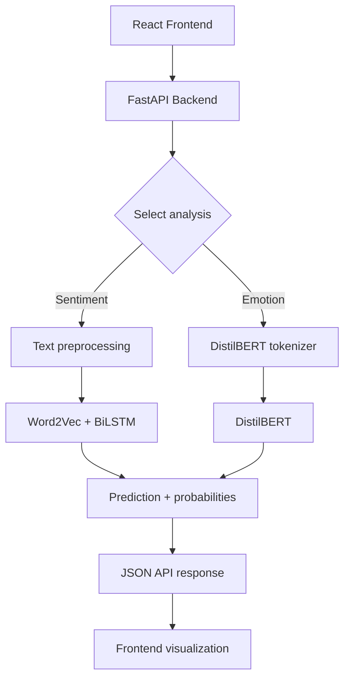

# NLP Lab — Frontend Product & Engineering Specification

> **Purpose:** A practical frontend blueprint for the NLP project.
>
> **Product concept:** An interactive NLP Analysis Dashboard with two model-powered experiences:
> 1. Review-rating prediction using Word2Vec Skip-gram + BiLSTM.
> 2. Multi-label emotion detection using fine-tuned DistilBERT.
>
> **Frontend:** React + TypeScript + Vite  
> **UI:** Tailwind CSS + shadcn/ui  
> **Backend:** FastAPI  
> **ML:** PyTorch  
> **Target:** Solo development, seven-day project timeline, free-tier deployment where available.

---

## 1. Product vision

Build an **interactive NLP Analysis Dashboard**, not merely a form that accepts text and returns a prediction.

The application should let users:

- Test both NLP models independently.
- Understand predictions and their probability scores.
- Explore the datasets and their label distributions.
- Learn how each model works.
- Inspect actual model evaluation results.
- Understand model limitations and implementation details.

The two model experiences should feel like parts of one coherent application, with a shared design system, navigation, and interaction patterns.

### 1.1 The two core models

| Experience | Model | Task | Expected output |
|---|---|---|---|
| Sentiment Analyzer | Word2Vec Skip-gram + BiLSTM | Five-class review-rating classification | Predicted rating from 1 to 5 stars, with class probabilities |
| Emotion Analyzer | Fine-tuned DistilBERT | Multi-label emotion classification | One or more of 27 emotions, or neutral, from the 28-label GoEmotions setup |

### 1.2 Important modelling distinctions

- The Amazon review model predicts a **customer rating class from review text**. It does not establish an objective or guaranteed measure of sentiment.
- GoEmotions is a **multi-label classification** problem. A text can express multiple emotions simultaneously.
- Do not force the emotion model to return exactly one emotion.
- Do not compare the two models using a single shared accuracy score; they solve different tasks.
- Never display invented metrics, probabilities, inference times, sample counts, model statuses, or deployment status.
- Any placeholder data used during UI development must be visibly labelled as illustrative or mock data.
- The frontend must display the model's actual output. It must not invent its own interpretation of the prediction.

---

## 2. Information architecture and navigation

Use a persistent sidebar on desktop and a responsive navigation drawer or compact navigation on smaller screens.

### 2.1 Recommended pages

| Page | Purpose | Priority |
|---|---|---|
| Dashboard | Overall project status, model summaries and recent analyses | P0 |
| Sentiment Analyzer | Predict 1–5 star rating from review text | P0 |
| Emotion Analyzer | Predict multiple emotions from text | P0 |
| Evaluation | Present actual test metrics and performance visualizations | P1 |
| Model Lab | Explain architectures, preprocessing and training | P1 |
| Dataset Explorer | Explore dataset composition and label distributions | P1 |
| Documentation | Methodology, API details, limitations and references | P1 |

### 2.2 Suggested sidebar order

1. Dashboard
2. Analyze
   - Sentiment Analyzer
   - Emotion Analyzer
3. Research
   - Dataset Explorer
   - Model Lab
   - Evaluation
4. Documentation

Keep both analyzers prominent. They are the application's primary user-facing features.

### 2.3 Global application shell

The shared shell should contain:

- Application name and logo/wordmark.
- Sidebar navigation with an unmistakable active-page state.
- Main content area with consistent page titles and descriptions.
- Model/API availability indicator based on a real backend health check.
- Responsive mobile navigation.
- Consistent loading, empty, error, disabled, and success states.
- Optional theme control, if time permits.

Do not show a model as "online" merely because the frontend loaded. The status must come from the backend.

---

## 3. Dashboard

The Dashboard should answer three questions immediately:

1. What can this application do?
2. Which models are available?
3. How well have the models performed on their evaluation data?

### 3.1 Recommended sections

| Component | Information |
|---|---|
| Model status | Availability of the sentiment and emotion models |
| Performance cards | Appropriate metrics for each model |
| Dataset overview | Sample counts, labels and split information |
| Recent analyses | Recent predictions, if history is implemented |
| Model comparison | Side-by-side architecture and evaluation summary |
| Quick actions | Direct links to both analyzers |

### 3.2 Dashboard behaviour

- Fetch model status from the backend rather than hardcoding it.
- Show a clear unavailable state if a model has not loaded.
- Show metrics only when a verified evaluation artifact is available.
- Identify whether each metric is from training, validation, or test data.
- Do not present mock data as real project results.
- If recent analysis history is not implemented, omit the section or show a clear empty state.
- Provide prominent actions to open the Sentiment Analyzer and Emotion Analyzer.

---

## 4. Sentiment Analyzer

### 4.1 Goal

Allow a user to enter a product review and receive the model's predicted rating class from 1 to 5, along with the class probability distribution.

### 4.2 User journey

1. User opens the Sentiment Analyzer.
2. User enters a product review or pastes review text.
3. User clicks **Analyze Sentiment**.
4. Frontend validates the input and sends it to FastAPI.
5. Backend applies the exact preprocessing used during training.
6. Backend runs the Word2Vec + BiLSTM model.
7. Frontend displays the predicted rating and class probabilities.

### 4.3 Input area

Include:

- Multiline text input.
- Character count.
- Clear/reset action.
- Analyze button.
- Disabled/loading button state while a request is in progress.
- Helpful sample text that users can load into the input.
- Client-side validation for blank or excessively long input.
- A clear note explaining that the prediction is based on review text.

Do not duplicate or silently alter the model's preprocessing in the browser. Tokenization and preprocessing should happen in the backend using the same logic and vocabulary assumptions used during training.

### 4.4 Result area

Display:

- Predicted rating from 1 to 5.
- Star visualization.
- Probability for each of the five classes.
- A horizontal probability distribution chart.
- Model name/version.
- Inference time, only if returned by the backend.
- Optional raw JSON/result details in an expandable technical section.

Example visual structure (the values below are **illustrative only**):

```text
Sentiment result
Predicted rating: 4 / 5 stars

Class probabilities:
1 star    2%
2 stars   4%
3 stars   9%
4 stars  65%
5 stars  20%
```

The interface should make it clear that the predicted rating is a model prediction, not a guaranteed rating or ground-truth sentiment label.

### 4.5 Edge cases

Handle:

- Empty input.
- Input containing only whitespace.
- Text beyond the backend's configured limit.
- Unsupported or malformed request.
- Backend unavailable.
- Model not loaded.
- Inference timeout.
- Missing or malformed probability output.
- Unexpected model response.

Never display a fabricated successful prediction when the API request fails.

---

## 5. Emotion Analyzer

### 5.1 Goal

Allow a user to enter a sentence, comment, or paragraph and see the emotions detected by the multi-label DistilBERT model.

### 5.2 User journey

1. User opens the Emotion Analyzer.
2. User enters a sentence, comment, or paragraph.
3. User clicks **Analyze Emotions**.
4. Frontend sends the text and, if supported, the selected threshold to FastAPI.
5. Backend tokenizes the text using the model's tokenizer.
6. Backend runs the fine-tuned DistilBERT model.
7. Backend applies the configured multi-label decision threshold.
8. Frontend displays selected labels and their scores.
9. User can expand the result to inspect all 28 label scores.

### 5.3 Result area

Include:

- Selected emotion labels.
- Ranked emotion scores.
- A probability/score bar for each label.
- Threshold used to select labels.
- A view of all 28 label scores.
- Model name/version.
- Inference time, only if returned by the backend.
- A concise explanation that multiple labels may be selected simultaneously.

Example visual structure (the values below are **illustrative only**):

```text
Detected emotions:
Excitement
Joy
Optimism

Example scores:
Excitement   0.91
Joy          0.84
Optimism     0.72
Admiration   0.38
Curiosity    0.24
```

The examples are not actual model results. The frontend must populate this view from the API.

### 5.4 Threshold control

A threshold selector can be included as an advanced control.

Recommended behaviour:

- Display the threshold used for the current prediction.
- If threshold selection is supported, send the selected value to the API or apply it only to returned scores according to the backend contract.
- Make it clear that changing the threshold changes which labels are selected; it does not retrain the model.
- Do not invent a default threshold. Read the configured default from the backend or use the explicitly agreed project configuration.
- Keep the full score list available regardless of which labels pass the threshold.

### 5.5 Neutral handling

The UI must follow the actual model's label mapping and post-processing rules for neutral. Do not assume neutral can be combined with every other emotion. Document and respect the project's chosen neutral-label handling.

### 5.6 Edge cases

Handle:

- Empty input.
- Input beyond the configured limit.
- No labels crossing the threshold.
- Neutral prediction.
- Multiple selected labels.
- Model/API unavailable.
- Missing label scores.
- Label mapping/version mismatch.
- Inference timeout.

If no label crosses the configured threshold, show a clear no-label-selected state. Do not silently select the highest-scoring label unless that behaviour is explicitly part of the backend's inference contract.

---

## 6. Dataset Explorer

This page makes the application useful as a research demonstration, not just an inference demo.

### 6.1 Amazon Reviews dataset

Recommended information:

- Total records in each verified split.
- Five-class rating distribution.
- Review length distribution.
- Missing-value counts.
- Duplicate-record counts.
- Label distribution for train, validation, and test splits.
- Sample reviews with their labels.
- Dataset split sizes.

### 6.2 GoEmotions dataset

Recommended information:

- Total records in each verified split.
- Distribution of all 28 labels.
- Most and least frequent emotions.
- Number or proportion of examples with multiple labels.
- Label-count-per-example distribution.
- Sample comments with their labels.
- Dataset split sizes.

### 6.3 Explorer interactions

Include:

- Dataset selector.
- Split selector (train, validation, test), where available.
- Label/category filter.
- Search within the displayed sample records.
- Pagination.
- Charts for label distributions and text lengths.
- Dataset metadata and source references.

### 6.4 Data handling requirements

- Do not load the entire dataset into the browser.
- The backend should provide compact summaries and paginated samples.
- Use verified manifests/statistics created during dataset auditing.
- Make the dataset split and source clear.
- Avoid exposing unnecessary raw user/comment data.
- If dataset statistics have not been produced, show an unavailable state rather than generating approximate values.

---

## 7. Model Lab

The Model Lab explains the model pipeline and implementation.

### 7.1 Model A: Word2Vec Skip-gram + BiLSTM

Show:

- Text input.
- Text normalization/tokenization stages, as actually implemented.
- Word2Vec vocabulary and embedding dimensions.
- Skip-gram training explanation.
- Embedding layer.
- BiLSTM architecture.
- Classification head.
- Five output classes.

Include model-specific configuration values only when they exist in the saved training configuration or experiment report.

### 7.2 Model B: DistilBERT

Show:

- Text input.
- DistilBERT tokenizer.
- Token IDs and attention mask concept.
- Transformer encoder.
- Multi-label classification head.
- 28 output labels.
- Sigmoid scores and threshold-based label selection.

### 7.3 Technical information

Where available, display:

- Architecture diagrams.
- Preprocessing pipeline.
- Vocabulary size.
- Embedding dimensions.
- Model parameter count.
- Training configuration and hyperparameters.
- Optimizer and learning rate.
- Batch size and number of epochs.
- Training and validation loss curves.
- Checkpoint name and model version.
- Model limitations.

### 7.4 Progressive detail

Offer two levels of explanation:

- **Overview:** A simple explanation for general users.
- **Technical view:** Detailed architecture and training information for evaluators/developers.

Do not fabricate architecture details or hyperparameters. Populate this page from configuration files or verified experiment metadata.

---

## 8. Evaluation

This is one of the most important pages for the academic demonstration.

### 8.1 Sentiment model metrics

Display appropriate metrics such as:

- Accuracy.
- Macro F1.
- Weighted F1.
- Precision per rating class.
- Recall per rating class.
- F1 per rating class.
- Confusion matrix.
- Classification report.

### 8.2 Emotion model metrics

Display appropriate multi-label metrics such as:

- Micro F1.
- Macro F1.
- Weighted F1, if computed and appropriate.
- Per-emotion precision and recall.
- Per-emotion F1.
- Multi-label confusion matrices.
- Threshold comparison results, if evaluated.

### 8.3 Additional evaluation information

Where measurements exist, include:

- Training versus validation curves.
- Inference latency.
- Model artifact size.
- Error analysis with incorrectly classified examples.
- Evaluation split and evaluation date/run identifier.
- Model/checkpoint version.

### 8.4 Evaluation integrity rules

- Never tune on the test set.
- Clearly distinguish training, validation and test metrics.
- Do not compare metrics from different splits as if they were equivalent.
- Do not present accuracy as the only measure for an imbalanced or multi-label task.
- Do not claim one model is better overall merely because one metric is numerically larger.
- Link displayed metrics to the corresponding experiment/run metadata when possible.
- If a metric is unavailable, omit it or label it as not measured.
- Do not produce sample-looking numbers to fill empty charts.

---

## 9. Frontend-to-backend architecture

Keep UI components, API communication, and model inference responsibilities separate.

### 9.1 High-level request flow



### 9.2 Responsibility boundaries

**React frontend**
- Collect input.
- Validate basic input constraints.
- Call the API.
- Display loading/error/success states.
- Visualize returned predictions and metrics.
- Never load the full training dataset.
- Never reimplement model inference.

**FastAPI backend**
- Validate request schemas.
- Apply model-consistent preprocessing/tokenization.
- Load and execute model artifacts.
- Apply configured post-processing and thresholds.
- Return structured, versioned responses.
- Provide model status, evaluation summaries and dataset metadata.
- Return useful errors without leaking secrets or stack traces to users.

**Model/inference layer**
- Load the correct checkpoint and associated vocabulary/tokenizer.
- Use the correct label mapping.
- Run inference in evaluation mode.
- Use inference/no-gradient execution.
- Return outputs in a stable format.
- Record model version and inference timing where implemented.

### 9.3 Suggested API endpoints

| Endpoint | Method | Purpose |
|---|---|---|
| `/api/v1/health` | GET | Backend health |
| `/api/v1/models` | GET | Model information and availability |
| `/api/v1/sentiment/predict` | POST | Predict 1–5 star rating |
| `/api/v1/emotion/predict` | POST | Predict emotion labels |
| `/api/v1/metrics` | GET | Evaluation metrics |
| `/api/v1/datasets/summary` | GET | Dataset statistics |
| `/api/v1/datasets/{dataset_name}/samples` | GET | Paginated sample records, if supported |

These are proposed endpoint names. Keep the frontend and backend in agreement; do not assume an endpoint exists until it has been implemented and tested.

---

## 10. Proposed API contracts

The following are suggested contracts. They are **not evidence that the backend endpoints already exist**. Implement both sides against one agreed schema.

### 10.1 Sentiment request

```json
{
  "text": "The product quality is excellent."
}
```

### 10.2 Sentiment response

```json
{
  "predicted_rating": 5,
  "probabilities": {
    "1": 0.01,
    "2": 0.02,
    "3": 0.04,
    "4": 0.13,
    "5": 0.80
  },
  "inference_time_ms": 18.4,
  "model_version": "sentiment-v1"
}
```

The probabilities and inference time above are illustrative. Actual values must come from inference.

### 10.3 Emotion request

```json
{
  "text": "I am really excited about this opportunity!",
  "threshold": 0.5
}
```

Only include `threshold` if the backend supports a request-level threshold. Otherwise use the backend's configured threshold and return it in the response.

### 10.4 Emotion response

```json
{
  "predicted_labels": ["joy", "excitement"],
  "scores": {
    "joy": 0.91,
    "excitement": 0.86,
    "anger": 0.02
  },
  "threshold": 0.5,
  "inference_time_ms": 42.1,
  "model_version": "emotion-v1"
}
```

For the full label-explorer experience, the backend should return scores for all 28 labels, not only the few shown in this abbreviated example.

### 10.5 Contract requirements

- Use stable field names and documented types.
- Return a predictable error schema.
- Return all five sentiment probabilities.
- Return all 28 emotion scores if full-label inspection is required.
- Return the threshold actually applied.
- Return the model version/checkpoint identifier where available.
- Include inference timing only when measured.
- Validate response shape on the frontend.
- Treat missing or malformed fields as an error state, not as zero-valued predictions.

---

## 11. Recommended frontend technology stack

| Layer | Technology | Reason |
|---|---|---|
| Framework | React + TypeScript + Vite | Fast development and typed UI |
| Styling | Tailwind CSS | Consistent utility-based styling |
| Components | shadcn/ui | Accessible, customizable primitives |
| Charts | Recharts | Dashboard charts and evaluation plots |
| Animations | Framer Motion | Subtle transitions |
| Icons | Lucide | Consistent icon set |
| API/state | TanStack Query | Request lifecycle, caching and retries |
| Routing | React Router | Page navigation |
| API client | Fetch or Axios | HTTP communication |
| Testing | Vitest + React Testing Library | Component and utility tests |
| E2E testing | Playwright | Critical user-flow verification |

### 11.1 Design-system guidance

Use shadcn/ui as the foundation. Add animation-oriented components selectively rather than turning every element into an animation.

Recommended principles:

- Reuse shared components.
- Define design tokens for spacing, typography, borders and colors.
- Keep charts visually consistent.
- Ensure keyboard navigation and accessible labels.
- Respect reduced-motion preferences.
- Avoid adding multiple libraries for the same purpose without a clear need.

---

## 12. Visual design direction

### 12.1 Theme

Use a dark, research-oriented dashboard with restrained violet/blue accents, clean typography, clear data visualizations and subtle transitions.

Suggested starting palette:

| Role | Hex |
|---|---|
| Background | `#10121B` |
| Surface | `#191D2A` |
| Primary accent | `#7775E8` |
| Border / muted surface | `#242B3A` |

These are starting design tokens, not mandatory fixed colors. Ensure contrast and accessibility before finalizing.

### 12.2 Visual principles

- Dark interface with violet/blue accents.
- Sidebar navigation on desktop.
- Collapsible navigation on mobile.
- Clear charts and readable typography.
- Consistent cards, tables, badges and empty states.
- Subtle animations only where they help explain state changes.
- No unnecessary gradients, glowing elements or excessive glassmorphism.
- Maintain readable contrast in charts and text.
- Use responsive layouts for mobile, tablet and desktop.

### 12.3 Responsive behaviour

**Desktop**
- Persistent sidebar.
- Multi-column dashboard cards.
- Charts can sit side by side when there is enough room.

**Tablet**
- Narrow or collapsible sidebar.
- Two-column card layout where practical.
- Charts stack when needed.

**Mobile**
- Drawer or compact navigation.
- Single-column content.
- Full-width analyzer input and result panels.
- Avoid horizontally overflowing tables; use responsive tables or card representations.

---

## 13. Suggested frontend folder structure

```text
frontend/
├── public/
│   ├── favicon.svg
│   └── assets/
├── src/
│   ├── app/
│   │   ├── App.tsx
│   │   ├── router.tsx
│   │   └── providers.tsx
│   ├── components/
│   │   ├── layout/
│   │   │   ├── AppShell.tsx
│   │   │   ├── Sidebar.tsx
│   │   │   ├── MobileNavigation.tsx
│   │   │   └── PageHeader.tsx
│   │   ├── dashboard/
│   │   ├── analyzers/
│   │   │   ├── TextInputPanel.tsx
│   │   │   ├── SentimentResult.tsx
│   │   │   ├── EmotionResult.tsx
│   │   │   └── ProbabilityBars.tsx
│   │   ├── charts/
│   │   ├── evaluation/
│   │   ├── datasets/
│   │   └── ui/
│   ├── pages/
│   │   ├── DashboardPage.tsx
│   │   ├── SentimentPage.tsx
│   │   ├── EmotionPage.tsx
│   │   ├── DatasetExplorerPage.tsx
│   │   ├── ModelLabPage.tsx
│   │   ├── EvaluationPage.tsx
│   │   └── DocumentationPage.tsx
│   ├── features/
│   │   ├── sentiment/
│   │   └── emotion/
│   ├── hooks/
│   ├── lib/
│   │   ├── api-client.ts
│   │   ├── query-client.ts
│   │   └── utils.ts
│   ├── services/
│   │   ├── sentiment-api.ts
│   │   ├── emotion-api.ts
│   │   ├── model-api.ts
│   │   └── evaluation-api.ts
│   ├── types/
│   │   ├── api.ts
│   │   ├── sentiment.ts
│   │   ├── emotion.ts
│   │   └── evaluation.ts
│   ├── styles/
│   │   └── globals.css
│   └── main.tsx
├── .env.example
├── package.json
├── tsconfig.json
└── vite.config.ts
```

Adapt this structure to the actual project. Do not create empty abstractions or folders solely to match the diagram.

---

## 14. Frontend implementation rules

### 14.1 API integration

- Keep API calls in service modules, not scattered across page components.
- Use a single configurable API base URL.
- Put local development URLs in environment configuration.
- Do not hardcode deployment URLs in source files.
- Use TanStack Query for request state and caching where useful.
- Set appropriate request timeouts.
- Avoid automatic retries for invalid input or non-retryable client errors.
- Show meaningful error messages.
- Do not expose backend secrets or credentials in frontend code.

### 14.2 State management

- Keep temporary form input state local to the analyzer.
- Keep API/server state in TanStack Query.
- Avoid adding a global state library unless the application genuinely needs one.
- Clear stale result panels when the user submits a new request or changes the input in a way that makes the displayed result misleading.
- Prevent duplicate submissions while a request is running.

### 14.3 Loading states

Show a visible loading state while the backend is processing.

Examples:

- Button changes to a loading state.
- Result panel displays a skeleton or progress indicator.
- Inputs/buttons are disabled only where necessary.
- Do not display a fabricated prediction while waiting.

### 14.4 Error states

Show a useful message for:

- Backend unreachable.
- Model unavailable.
- Invalid text input.
- Request timeout.
- Unexpected API response.
- Server-side validation failure.

Provide a retry action when retrying is appropriate. Do not expose raw stack traces to end users.

### 14.5 Accessibility

- Every input must have a visible or programmatic label.
- Buttons must be keyboard accessible.
- Use semantic headings and landmarks.
- Maintain sufficient color contrast.
- Do not rely on color alone to communicate a prediction.
- Provide text alternatives for charts or key chart values.
- Respect reduced-motion preferences.

---

## 15. Testing and quality assurance

### 15.1 Component tests

Test:

- Input validation.
- Character count.
- Disabled/loading button states.
- Sentiment result rendering.
- Emotion result rendering.
- Empty/no-label-selected state.
- Error messages.
- Responsive navigation behaviour.

### 15.2 API integration tests

Verify:

- Correct request body for sentiment prediction.
- Correct request body for emotion prediction.
- Successful response parsing.
- Handling of non-2xx responses.
- Handling of timeout/network failure.
- Handling of missing or malformed response fields.
- Model availability indicator behaviour.

### 15.3 End-to-end tests

At minimum, test these flows:

1. Open dashboard.
2. Navigate to Sentiment Analyzer.
3. Submit valid text.
4. Verify the returned rating and five probabilities are displayed.
5. Navigate to Emotion Analyzer.
6. Submit valid text.
7. Verify selected labels and scores are displayed.
8. Simulate backend failure.
9. Verify a useful error state is shown.
10. Navigate between all main pages at desktop and mobile widths.

### 15.4 Release checks

- No console errors in main user journeys.
- No broken navigation links.
- No overflowing content at mobile widths.
- No fake metrics or predictions in production UI.
- API base URL is environment-configured.
- Loading, error and empty states work.
- Important pages have meaningful page titles.
- Frontend build completes successfully.

---

## 16. Development priorities

With a seven-day solo development target, build the product in this order.

| Priority | Feature | Importance |
|---|---|---|
| P0 | Dashboard shell and navigation | Essential |
| P0 | Sentiment Analyzer | Essential |
| P0 | Emotion Analyzer | Essential |
| P0 | FastAPI integration and error handling | Essential |
| P1 | Evaluation dashboard | Very high |
| P1 | Model Lab | High |
| P1 | Dataset Explorer | High |
| P1 | Documentation | High |
| P2 | Batch CSV analysis | Optional |
| P2 | Experiment comparison | Optional |
| P2 | Embedding visualization | Optional |

### Suggested build sequence

**Phase 1 — Foundation**
- Initialize React + TypeScript + Vite.
- Configure Tailwind and shadcn/ui.
- Set up routing.
- Create the application shell and responsive navigation.
- Define shared typography, color and spacing tokens.

**Phase 2 — Core model experiences**
- Build the Sentiment Analyzer input/result flow.
- Build the Emotion Analyzer input/result flow.
- Create typed request/response contracts.
- Integrate both FastAPI endpoints.
- Implement loading, empty and error states.

**Phase 3 — Research presentation**
- Add dashboard summaries.
- Add Evaluation page using verified experiment results.
- Add Model Lab architecture explanations.
- Add Dataset Explorer summaries and paginated samples.
- Add Documentation page.

**Phase 4 — Verification and release**
- Test both end-to-end inference flows.
- Test backend-unavailable behaviour.
- Verify responsive layout.
- Remove any temporary mock data from production views.
- Build and deploy the frontend.
- Verify the deployed frontend can reach the deployed API.

Do not start optional features until both primary analyzers work end to end.

---

## 17. Explicit non-goals for the first release

To protect the seven-day schedule, do not make these necessary for the first usable version:

- User accounts and authentication.
- Persistent user prediction history.
- Real-time collaborative analysis.
- Large-scale batch processing.
- Retraining models from the browser.
- Editing the training dataset.
- Complex experiment tracking UI.
- Live GPU monitoring.
- An elaborate admin panel.

These can be added later if the core application is stable.

---

## 18. Acceptance criteria

The frontend is ready for the first release when all of the following are true:

### Application shell
- [ ] All primary pages are reachable through navigation.
- [ ] Sidebar/mobile navigation works.
- [ ] Layout is usable on desktop, tablet and mobile.
- [ ] Shared visual design is consistent.

### Sentiment Analyzer
- [ ] User can enter review text.
- [ ] Empty input is rejected clearly.
- [ ] Request reaches the real FastAPI endpoint.
- [ ] Predicted rating is rendered from the API response.
- [ ] All five class probabilities are displayed.
- [ ] Backend/network failure is handled without fake output.

### Emotion Analyzer
- [ ] User can enter text.
- [ ] Request reaches the real FastAPI endpoint.
- [ ] Multiple predicted labels can be displayed.
- [ ] Full 28-label scores can be explored when returned by the API.
- [ ] Threshold information is visible and accurate.
- [ ] No-label-selected state is handled.
- [ ] Backend/network failure is handled without fake output.

### Research pages
- [ ] Dashboard uses real model status and verified metrics.
- [ ] Dataset Explorer uses verified dataset statistics.
- [ ] Model Lab describes the actual trained models.
- [ ] Evaluation uses the correct split and metric definitions.
- [ ] Documentation explains task definitions and limitations.

### Quality
- [ ] Loading, empty and error states are implemented.
- [ ] No secrets are exposed in frontend source.
- [ ] No fabricated results are shown.
- [ ] Critical user flows pass tests.
- [ ] Production build succeeds.

---

## 19. Guidance for an AI coding agent

When using this document with GitHub Copilot, Gemini, Claude Code, or another coding agent, follow these instructions:

1. Read the entire specification before editing files.
2. Inspect the existing repository before creating or replacing files.
3. Report the detected frontend framework, folder structure, existing components, dependencies and current implementation status.
4. Preserve working code unless a change is justified.
5. Implement the project in phases, starting with the application shell and the two analyzers.
6. Confirm the actual FastAPI routes and schemas before implementing API calls. If the backend is not ready, create typed service interfaces and clearly labelled development mocks; never present mocks as real predictions.
7. Keep API contracts in shared TypeScript types.
8. Use environment variables for API configuration and provide `.env.example`.
9. Build reusable components without overengineering.
10. Use actual model metadata and evaluation artifacts for research pages.
11. Do not fabricate model metrics, predictions, dataset sizes, latency, training details, or deployment status.
12. Add loading, error, empty and success states.
13. Test each major feature before moving to the next.
14. Run the production build and report its exact result.
15. If a feature cannot be completed, report it as `BLOCKED` or `NOT IMPLEMENTED`, explain why, and identify the files or API contract involved.

### 19.1 Required progress report

At the end of each implementation phase, report:

| Field | Required information |
|---|---|
| Phase | Phase name/number |
| Status | PASS / FAIL / BLOCKED / PARTIAL |
| Files created | Exact paths |
| Files modified | Exact paths |
| Dependencies | Added/removed packages |
| Tests | Commands run and actual results |
| Build | Exact command and result |
| API integration | Endpoints verified or still pending |
| Known issues | Reproduction steps and error details |
| Next phase | Specific next implementation task |

Do not mark a phase `PASS` merely because code was generated. Run the relevant checks and report evidence.

---

## 20. Final product recommendation

Make the **Sentiment Analyzer** and **Emotion Analyzer** the centrepieces of the application.

The Dashboard introduces the project, the Dataset Explorer explains the data, the Model Lab explains the algorithms, and the Evaluation page demonstrates how well the models work.

This creates a coherent academic NLP product rather than two unrelated machine-learning demos.

The best first release is a smaller, reliable application with two working inference flows and honest evaluation data—not a large interface full of unfinished features or simulated results.


---

## 21. Cinematic animated footer — integration specification

**Component reference:** `motion-footer.tsx` from the supplied footer prompt/source.

Integrate the supplied animated React footer into the NLP Lab application. Treat the supplied code as a visual and animation reference, not as an instruction to retain its original product branding or irrelevant links.

### 21.1 Placement and purpose

- Render the footer at the bottom of the shared application shell so it appears consistently across the main pages.
- The footer should feel like the final section of a polished research/product website.
- Preserve the supplied cinematic scroll-reveal concept: page content scrolls above a fixed footer that is progressively revealed.
- Check the interaction with the existing app shell, page heights, sticky elements, and scroll containers before enabling the fixed-footer effect globally.
- If the effect interferes with scrolling, accessibility, mobile navigation, or nested scroll areas, use a normal-flow responsive footer while retaining the visual language and entrance animations.

### 21.2 Rebrand for NLP Lab

The supplied component contains unrelated copy and branding, including “SOBERS”, “Volvox”, app-store downloads, privacy/terms/support links, and recovery-product messaging. Replace these with accurate NLP Lab content.

Suggested content:

**Large background word**
- `NLP LAB` or `NLP`

**Marquee phrases**
- `Sentiment Analysis`
- `Emotion Detection`
- `Word2Vec + BiLSTM`
- `DistilBERT`
- `Explainable Evaluation`

**Main heading**
- `Explore language. Understand emotion.`

**Primary actions**
- `Try Sentiment Analyzer` → actual Sentiment Analyzer route.
- `Try Emotion Analyzer` → actual Emotion Analyzer route.

**Secondary navigation**
- `Model Lab` → actual Model Lab route.
- `Evaluation` → actual Evaluation route.
- `Documentation` → actual Documentation route.
- `GitHub` → use a real repository URL only if configured and verified; otherwise omit.

**Bottom bar**
- `© [current year] NLP Lab. All rights reserved.` Use the current year dynamically or maintain it in central configuration.
- Replace “Crafted with love by Volvox” with `Built for NLP research and experimentation`.
- Keep a functional back-to-top control.

Do not invent a project website, repository, email address, social account, privacy policy, terms page, or external destination. Omit links that do not exist. Do not leave placeholder `href="#"` links in the finished application.

### 21.3 Technical requirements

The supplied implementation uses React + TypeScript, GSAP, GSAP ScrollTrigger, Tailwind CSS, shadcn-style theme tokens, and `cn` from `@/lib/utils`.

Before integrating:

1. Inspect `package.json`, Tailwind setup, TypeScript configuration, path aliases, global CSS, and shadcn component directory.
2. Confirm whether `@/components/ui` and `@/lib/utils` exist. Adapt imports to the actual project structure if needed.
3. Install `gsap` only if it is not already installed.
4. Register `ScrollTrigger` safely in the browser.
5. Use GSAP context and cleanup so React Strict Mode and route changes do not leave duplicate animations or scroll triggers.
6. Clean up event listeners, GSAP timelines, and ScrollTriggers on unmount.
7. Keep the component self-contained; do not add unnecessary state-management libraries or providers.
8. Use the project's existing router for internal navigation.
9. Keep external links limited to verified destinations.
10. Avoid injecting untrusted content into the page.

### 21.4 Required code review and fixes

Do not copy the supplied code blindly. Inspect and correct issues during integration, including:

- The supplied demo wrapper contains malformed Tailwind class strings such as `bg-background]` and `shadow-m]`; do not reproduce these typos.
- Replace all unrelated product copy and branding.
- Remove app-store buttons unless the project actually has published mobile apps.
- The supplied `MagneticButton` combines button and anchor prop types and uses broad casts. Improve its typing or replace it with accessible typed button/link variants.
- Do not attach button-only props to anchors or anchor-only props to buttons.
- Disable or simplify magnetic hover on touch devices and for users who prefer reduced motion.
- Ensure the mouse-move calculation uses the correct element centre and dimensions.
- Call `window.scrollTo` only from a browser interaction.
- The footer's `h-screen` and `fixed` positioning can create overlap or unusual scroll behaviour. Test long pages, short pages, mobile browsers, and pages with their own scroll containers.
- Ensure the footer does not cover keyboard focus, content, notices, or mobile navigation.
- Respect `prefers-reduced-motion`: remove or substantially reduce parallax, magnetic movement, marquee animation, and scroll-scrub effects.
- Ensure text remains readable if animation fails or GSAP cannot initialize.
- Load Plus Jakarta Sans only if it fits the project's font strategy. Prefer the existing font setup if one is already configured.
- Verify theme tokens such as `--foreground`, `--background`, `--primary`, `--secondary`, `--border`, and `--destructive` actually exist. Add compatible fallbacks or use existing tokens rather than assuming a particular shadcn theme version.
- Ensure the footer remains usable in both light and dark themes if the application supports both.

### 21.5 Visual and responsive requirements

Preserve the reference's core visual character:

- Large, low-contrast typographic background word.
- Subtle grid and aurora-style ambient background.
- Diagonal marquee band.
- Glass-like pill links.
- Strong central CTA heading.
- Scroll-triggered reveal and restrained parallax.
- Magnetic hover response on suitable pointer devices.
- Back-to-top control.

Adapt sizing and spacing to the NLP Lab design system. Avoid excessive glow, visual noise, or animations that compete with the analyzers and charts.

Test at:
- Mobile width around 360–390 px.
- Tablet width around 768 px.
- Desktop width around 1280–1440 px.
- Large desktop width around 1920 px.

At small widths, the marquee, heading, links, and bottom bar must wrap or scale without horizontal overflow.

### 21.6 Accessibility and performance

- Use a semantic `<footer>` landmark.
- Use real links for navigation and real buttons for actions.
- Provide visible keyboard focus styles.
- Give the back-to-top button an accessible name such as `Back to top`.
- Do not use animation as the only way to reveal important information.
- Respect `prefers-reduced-motion`.
- Avoid layout shifts caused by late font loading.
- Avoid excessive continuous animation when the footer is off-screen.
- Verify ScrollTrigger refresh behaviour after route changes and content layout changes.
- Keep the component performant on mid-range mobile devices.

### 21.7 Footer integration acceptance checklist

- [ ] Footer is integrated into the shared app layout.
- [ ] All original unrelated brand/product copy has been replaced.
- [ ] Primary links navigate to real NLP Lab routes.
- [ ] No placeholder `href="#"` links remain.
- [ ] GSAP and ScrollTrigger initialize without console errors.
- [ ] GSAP contexts and ScrollTriggers are cleaned up correctly.
- [ ] Footer does not obscure page content or navigation.
- [ ] Long-page and short-page scrolling both work.
- [ ] Mobile layout has no horizontal overflow.
- [ ] Keyboard navigation and focus states work.
- [ ] Reduced-motion preference is respected.
- [ ] Back-to-top control works.
- [ ] Production build succeeds.

### 21.8 Instructions to the AI coding agent

Integrate the supplied `motion-footer.tsx` source as the starting point. First inspect the existing application shell and router. Then:

1. Report the current layout and the exact file where the footer should be mounted.
2. Confirm dependencies and theme tokens.
3. Create or adapt the footer component in the project's correct component directory.
4. Replace irrelevant branding, copy, and links with the NLP Lab content specified above.
5. Fix typing, accessibility, responsive behaviour, reduced-motion support, and lifecycle cleanup.
6. Mount the footer once in the shared layout rather than duplicating it on individual pages.
7. Test navigation, scroll reveal, back-to-top, mobile layout, and production build.
8. Report exact files created/modified, dependency changes, test commands, results, and remaining limitations.

Do not claim integration is complete until the footer is mounted in the real application and the acceptance checklist has been tested.


---

# 22. Reference-Driven Visual and Motion System — 21st.dev Components

## 22.1 Objective

Extend the existing NLP Lab frontend into a cohesive, research-grade experience by adapting the supplied 21st.dev references. The goal is **one consistent visual language**, not a collection of unrelated demos.

The implementation agent must:
- Inspect every reference before implementation.
- Recreate/adapt the visual principles and interaction patterns, not blindly paste components.
- Preserve the existing NLP Lab information architecture, API contracts, model behaviour, and truthful data requirements.
- Group work into the implementation phases in Section 23.
- Use the IDE skills listed in Section 24 only when relevant to the current phase.
- Build incrementally, test each phase, and report exact progress and failures.

The references are inspiration and implementation starting points. They are not permission to add unrelated product content, fake model data, or unnecessary animation.

## 22.2 Reference inventory and intended use

| Reference | Intended NLP Lab placement | Verified reference characteristics | Adaptation requirements |
|---|---|---|---|
| [Animator Title Preloader](https://21st.dev/@kedhareswer/components/animator-title-preloader) | First visit / initial application preloader | Staged title-card animation; title progresses through visual production stages; React + Tailwind; reduced-motion support is mentioned by the author | Rebrand as `NLP Major Project`. Use once per browser session or first app entry, not on every route. Keep it short and skippable. |
| [Ink Hero](https://21st.dev/@ryanonline1234/components/ink-hero) | Main landing page | Scroll-driven ink-wash-to-print reveal, expanding image, line-by-line headline reveal; reference describes GSAP ScrollTrigger and a reduced-motion static page | Adapt the ink/reveal metaphor to language, text, and NLP. Do not use unrelated Japanese art copy or imagery. Ensure hero content and CTAs remain immediately understandable. |
| [Hero Parallax](https://21st.dev/@manuarora700/components/hero-parallax) | Model Lab page | Scroll effects involving rotation, translation, and opacity | Use for model cards, architecture layers, or model visual panels. Do not create a distracting product-card wall or imply models/features that do not exist. |
| [Hero 3](https://21st.dev/@ravikatiyar162/components/hero-3) | Technology Used page | Animated text reveal and an infinite image marquee | Replace demo imagery with actual technology marks, architecture visuals, or carefully designed typographic tiles. Use only technologies genuinely present in the repository. |
| [Circle Reveal Loader](https://21st.dev/@goodmotion/components/circle-reveal-loader) | Main-page-to-route transitions | Staggered circular ripple/reveal transition; GSAP-based example | Use as a brief route transition overlay. Must not block navigation, trap focus, or replay on every tiny state change. |
| [Liquid Loader](https://21st.dev/@ravikatiyar162/components/liquid-loader) | Statistics / metrics loading | Fluid blob-style loader with vibrant gradients; described for futuristic loading states and dark UIs | Use only while actual statistics are being fetched or computed. Do not show indefinitely or use as a substitute for an error/empty state. |
| [Loader 10](https://21st.dev/@ravikatiyar162/components/loader-10) | Analysis result loading | Gooey/liquid-like loader | Use for the wait state after a valid sentiment/emotion analysis request. Pair with concise status text and a timeout/error path. |
| [Loding](https://21st.dev/@shailendrakumar19999/components/loding) | Model-prediction loading | The public page gives only a generic loading description and a minimal component usage example | Inspect the live preview and source before deciding whether it adds a distinct useful state. Do not assume its behaviour from the name. If it duplicates Loader 10, omit it or use it only for a clearly different model-initialization state. |

**Reference-access caveat:** 21st.dev pages expose previews and usage snippets, while some component source is available only after account access. The agent must verify source availability and licensing/attribution requirements at implementation time. Do not claim to have copied or integrated original source when only a preview or usage snippet was accessible.

## 22.3 Visual direction and colour theory

### Design concept: “Language Intelligence Lab”

The interface should communicate:
- **Trust and analytical clarity:** blue/cyan family for primary information and navigation.
- **Intelligence and experimentation:** restrained violet for AI/model-related accents.
- **Positive/active states:** controlled mint/teal accents.
- **Caution and uncertainty:** amber for warnings, low-confidence notices, and non-blocking caveats.
- **Neutral research workspace:** deep ink/navy backgrounds and layered slate surfaces.

This palette is selected as a product-design recommendation, not as a scientific guarantee that a colour produces a particular user response.

### Suggested dark theme tokens

| Token | Suggested value | Use |
|---|---|---|
| `--background` | `#080D18` | Main application background |
| `--surface` | `#101A2B` | Cards and panels |
| `--surface-elevated` | `#17243A` | Dialogs, popovers, elevated panels |
| `--border` | `#26364D` | Dividers and card borders |
| `--text-primary` | `#F2F6FC` | Main readable text |
| `--text-secondary` | `#A8B6CA` | Supporting labels |
| `--primary` | `#55C7E8` | Primary actions, links, key data |
| `--primary-strong` | `#26A9D1` | Hover/active primary state |
| `--accent-ai` | `#9185FF` | AI/model identity and selected highlights |
| `--success` | `#62D6AE` | Success/positive status |
| `--warning` | `#F2BE68` | Warnings and uncertainty |
| `--danger` | `#F17C88` | Errors and destructive states |

The agent may tune these values after contrast testing, but must keep the semantic roles consistent. Do not use every accent at full intensity simultaneously.

### Light theme

If a light theme already exists or is required, implement semantic equivalents rather than inverting colours mechanically:
- Warm near-white background.
- White or very pale blue-gray surfaces.
- Dark navy text.
- Deep cyan primary actions.
- Violet only for model/AI accents.
- Maintain accessible contrast for all text, controls, charts, and loader labels.

### Colour and data semantics

- Do not encode sentiment classes or emotion labels by colour alone.
- Use text labels, icons, and/or patterns alongside colour.
- Do not imply that a predicted rating is a verified customer rating.
- Use amber or neutral styling for low-confidence/ambiguous predictions; do not style uncertainty as success.
- Keep chart series colours consistent across dashboard, evaluation, and model lab.

## 22.4 Shared motion language

All motion must feel like part of one system:
- **Reveal:** ink, mask, opacity, and clip-path reveals for major page entrances.
- **Transition:** circular ripple for route changes.
- **Depth:** restrained parallax for selected hero/model visuals.
- **Continuous motion:** marquee only on the Technology Used page and only when useful.
- **Feedback:** short, subtle transitions for buttons, tabs, cards, and form states.
- **Waiting:** distinct loaders for initial app entry, route transitions, API requests, and metrics fetches.

Do not run multiple high-intensity effects in the same viewport at the same time. The main landing page may be cinematic; analysis forms and result screens must prioritize speed, readability, and confidence.

### Motion timing guidance

Use these as initial tuning targets, then test on real devices:
- Micro-interactions: 120–220 ms.
- Standard component transitions: 180–320 ms.
- Route reveal: approximately 450–850 ms.
- Hero scroll sequence: progress tied to scroll, with no forced long scroll lock.
- Initial title preloader: target a short presentation (roughly 1.5–2.5 seconds) and allow skip/early completion when the app is ready.

Never delay access to the actual application just to finish a decorative animation. If loading takes longer, transition to a real progress or status state.

## 22.5 Page-by-page design integration

### A. Initial title preloader — “NLP Major Project”

- Show the exact title `NLP Major Project`.
- Use the Animator Title Preloader as the visual reference.
- Use the NLP Lab palette and typography.
- Avoid unrelated portfolio, film-production, or cartoon-hand branding unless the source component's visual treatment can be adapted cleanly.
- Show only on first entry/session according to a documented rule; do not show on every route navigation.
- Skip when `prefers-reduced-motion` is enabled.
- If app initialization completes early, finish the animation early.
- If initialization fails, show an actionable error/retry state rather than leaving the user on an endless preloader.
- Ensure the preloader does not conceal an accessibility announcement or keyboard focus.

### B. Main landing page — Ink Hero

- Use Ink Hero as the primary landing-page inspiration.
- Hero message should explain the project: sentiment/rating prediction and multi-label emotion detection from text.
- Suggested headline: `Understand what language expresses.`
- Supporting copy must accurately describe the two implemented model experiences.
- Primary CTAs: `Try Sentiment Analysis` and `Explore Emotion Detection`.
- Secondary route/link: `Explore Model Lab`.
- Use a relevant abstract text/language visualization, typography, or project-owned visual. Do not use a random stock image that has no relationship to NLP.
- Scroll reveal may develop the visual from subtle ink/noise texture to a clean, legible final composition.
- Keep the headline, description, and CTAs visible and usable without waiting for scroll animation.
- If WebGL is used, provide a CSS/static fallback and lazy-load the heavy effect.

### C. Model Lab page — Hero Parallax

- Use parallax as an introduction to the actual model pipeline.
- Represent the two real model tracks:
  1. Word2Vec Skip-gram + BiLSTM for 1–5 rating classification.
  2. Fine-tuned DistilBERT for 28-label multi-label emotion classification.
- Use real architecture diagrams, labels, and model metadata only when present in the repository or model artifacts.
- Parallax should be subtle: foreground model cards or architecture layers may shift/rotate slightly as the user scrolls.
- Keep technical descriptions readable and selectable; do not put critical content inside a canvas-only animation.
- Include static layout fallback for reduced motion and small screens.
- Do not fabricate parameter counts, training times, accuracy, F1, dataset sizes, or benchmark results.

### D. Technology Used page — Hero 3 / Animated Marquee Hero

- Use the animated marquee concept for a technology showcase.
- Populate it from a verified technology manifest or actual project dependencies.
- Candidate technologies may include React, TypeScript, Vite, Tailwind CSS, FastAPI, PyTorch, Gensim, Hugging Face Transformers, scikit-learn, and ONNX Runtime, but display a technology only if the project actually uses or has successfully integrated it.
- Separate categories such as Frontend, Backend, ML/NLP, and Deployment.
- Use technology logos only when licensing and source are clear; otherwise use typographic tiles.
- Pause or reduce marquee motion when hovered/focused where practical, and respect reduced-motion settings.
- Do not show a tool as “used” merely because it appears in the proposed stack or this specification.

## 22.6 Loading-state system — use the correct loader for the correct event

Create a shared loading-state API/component layer. Avoid one generic loader being copied across every page.

| Loading event | Reference | Required behaviour |
|---|---|---|
| First application entry | Animator Title Preloader | Branded, one-time, brief; `NLP Major Project` |
| Navigation between major routes | Circle Reveal Loader | Short overlay/reveal; route remains accessible; avoid duplicate transitions |
| Fetching dashboard statistics | Liquid Loader | Only while metrics request is pending; show a label such as `Loading project statistics…` |
| Sentiment or emotion analysis request | Loader 10 | Show `Analyzing review…` or `Detecting emotions…`; prevent duplicate submissions |
| Model cold start / model initialization | Loding, only if source inspection proves useful | Show only for genuine model initialization, not every API request; otherwise use a simpler shared status component |

### Mandatory loading-state behaviour

Every loader must have:
- A clear trigger tied to a real state (`isLoading`, request status, route transition, or initialization status).
- A completion condition.
- An error state.
- A timeout or stalled-request strategy.
- An accessible text status (`role="status"` or equivalent appropriate semantics).
- A reduced-motion alternative.
- No fake percentage or progress bar unless the backend reports real progress.
- No indefinite animation after a request has completed or failed.

Do not use a loader for an empty dataset, a failed API call, a zero-result response, or a completed analysis. Those require their own explicit UI states.

## 22.7 Route transition architecture

- Use the existing router's supported navigation lifecycle.
- Build one reusable route-transition coordinator.
- Trigger the circle reveal only for meaningful top-level route changes.
- Avoid transition loops caused by state updates, query-string changes, or nested tab navigation.
- Do not delay browser back/forward navigation excessively.
- Clean up GSAP timelines, ScrollTriggers, observers, and event listeners on unmount.
- Prevent multiple overlays when users click quickly.
- Keep focus management correct after navigation; focus should land on the destination page heading or main content where appropriate.
- If route-transition integration conflicts with router behaviour, prefer a simple opacity/clip transition over a fragile custom navigation system.

## 22.8 Technical implementation constraints

1. Inspect the existing repository before installing dependencies or changing architecture.
2. Reuse the current router, theme system, component conventions, and animation packages where possible.
3. Do not install GSAP, Lenis, WebGL libraries, or other packages without checking whether they are already present and whether the reference actually needs them.
4. Avoid adding Lenis or scroll snapping globally merely because a reference demo uses them. They can interfere with browser-native scrolling, accessibility, and nested scroll containers.
5. Use GSAP context/scoped selectors and clean up ScrollTriggers/timelines in React effects.
6. Avoid mixing GSAP and Framer Motion on the same element/property unless there is a clear reason and ownership is explicit.
7. Lazy-load expensive visual effects and avoid blocking the initial application bundle.
8. Use CSS transforms and opacity for routine motion; avoid repeated layout-triggering animation.
9. Provide static fallbacks for WebGL, canvas, image filters, and parallax.
10. Respect `prefers-reduced-motion` globally, not just in one component.
11. Avoid fixed full-screen loaders that can trap users or cover content after completion.
12. Keep all animation components typed, reusable, and isolated from API/business logic.

## 22.9 Accessibility, responsiveness, and performance

### Accessibility
- Respect `prefers-reduced-motion: reduce`.
- All interactive elements must be keyboard accessible.
- Provide visible focus indicators.
- Do not communicate loading, error, success, sentiment, or emotion through colour alone.
- Ensure animated text remains available to screen readers in a sensible reading order.
- Do not announce every animation frame or marquee item.
- Pause non-essential continuous animation when the user requests reduced motion.
- Ensure route transitions do not steal focus unpredictably.

### Responsive checks
Test at minimum:
- 360 × 800
- 390 × 844
- 768 × 1024
- 1280 × 800
- 1440 × 900
- 1920 × 1080

On touch devices:
- No hover-only content.
- No pointer-dependent interaction as the only way to reveal information.
- Reduce parallax intensity.
- Disable expensive continuous effects when necessary.
- Avoid horizontal overflow from marquees and oversized typography.

### Performance checks
- No avoidable long tasks during route changes.
- No repeated ScrollTrigger creation after React re-renders.
- No memory leaks after navigating between pages.
- No layout shift caused by late-loading hero media.
- No animation that makes text or form controls hard to use.
- Measure before optimizing; record actual Lighthouse/browser findings rather than inventing scores.

## 22.10 Component ownership and suggested structure

Adapt to the repository's existing conventions; do not force this structure if an equivalent exists.

```text
frontend/src/
  components/
    motion/
      AppPreloader.tsx
      RouteReveal.tsx
      MotionProvider.tsx
      ReducedMotion.tsx
      ScrollReveal.tsx
    loaders/
      StatisticsLoader.tsx
      AnalysisLoader.tsx
      ModelInitializationLoader.tsx
      LoadingStatus.tsx
    heroes/
      InkLandingHero.tsx
      ModelLabParallaxHero.tsx
      TechnologyMarqueeHero.tsx
  hooks/
    useReducedMotion.ts
    useRouteTransition.ts
  styles/
    motion.css
    theme.css
```

Keep page-specific copy and data outside generic motion primitives. A loader component must not make API calls itself; it receives state from the owning page or data hook.

## 22.11 Implementation acceptance checklist

- [ ] Initial preloader displays `NLP Major Project` and runs according to the documented first-entry rule.
- [ ] Main landing page uses the ink-reveal visual direction and has working CTAs.
- [ ] Model Lab uses restrained parallax tied to real model information.
- [ ] Technology Used page marquee lists only verified technologies.
- [ ] Route reveal works for intended top-level navigation and does not break back/forward.
- [ ] Statistics loader is connected to actual statistics request state.
- [ ] Analysis loader is connected to actual sentiment/emotion request state.
- [ ] Model initialization loader is used only for a real initialization state, if implemented.
- [ ] Every loader has completion, error, timeout/stall, and reduced-motion behaviour.
- [ ] No fabricated progress, model metrics, or technology claims.
- [ ] GSAP timelines, ScrollTriggers, and listeners are cleaned up.
- [ ] No duplicate animation instances under React Strict Mode.
- [ ] Keyboard, screen-reader status, and focus behaviour are acceptable.
- [ ] All required viewport sizes have been checked.
- [ ] No horizontal overflow or loader overlay trapping.
- [ ] Production build and relevant automated tests pass.

---

# 23. Agent Execution Prompt — Work in Ordered Parts

## 23.1 Global instruction

You are the frontend implementation agent for **NLP Lab / NLP Major Project**. Your task is to implement the existing frontend specification plus the visual and motion system in Sections 21–22.

Work in the parts below. Similar tasks are grouped together. Do not attempt a massive one-shot rewrite. Inspect first, implement in controlled phases, test each phase, and preserve working functionality.

### Non-negotiable rules

- The existing repository is the source of truth for current implementation.
- The existing frontend product specification is the source of truth for product scope and page purpose.
- This document is the source of truth for the requested visual references and motion assignments.
- Do not fabricate API responses, model outputs, metrics, technologies, test results, or deployment status.
- Do not silently replace the stack, router, state-management approach, or component library.
- Do not delete functioning features to make the visual implementation easier.
- Do not add dependencies until their need is demonstrated.
- If a reference's source cannot be accessed, record that limitation and implement an original adaptation based on the verified preview/description.
- If a feature is not feasible or causes accessibility/performance regressions, report it and propose the closest safe alternative.
- Keep the frontend usable if all animation libraries fail to load.

## 23.2 Part 0 — Repository reconnaissance and skill discovery

**Goal:** Understand the actual project before changing anything.

1. Inspect the complete frontend folder structure and package manifest.
2. Identify the framework/build tool, router, styling system, component library, icon library, chart library, animation dependencies, and test setup.
3. Identify current pages, shared layouts, navigation, theme tokens, and API integration.
4. Inspect current loading states and existing animations to avoid duplication.
5. Inspect the 21st.dev links and previews. Check source availability, dependency requirements, and licence/attribution details.
6. Discover which of the user-listed IDE skills are actually installed and callable. Do not assume that a skill exists just because it is listed in this document.
7. Produce a baseline report before editing.

**Use these skills where available:**
- `reference-driven-ui-engineering` — inspect and translate the supplied references into an implementation plan.
- `web-design-guidelines` — audit current usability, hierarchy, accessibility, and responsive behaviour.
- `sota-app-builder` — understand the full app structure and preserve integration boundaries.
- `typescript-setup` — only if TypeScript configuration needs setup or repair.

**Required output:** repository map, current design-system summary, installed dependency inventory, route/page inventory, skill availability report, reference-access report, baseline build/test status, and a phased implementation plan.

**Stop condition:** Do not begin major visual implementation if the app cannot build or the current failure is not documented.

## 23.3 Part 1 — Design system and visual identity

**Goal:** Establish one consistent design language before building individual heroes.

1. Implement/tune semantic theme tokens from Section 22.3.
2. Define typography scale, spacing scale, radii, shadows, borders, content widths, and responsive breakpoints.
3. Define semantic colour tokens for primary, AI accent, success, warning, danger, and neutral states.
4. Check text, buttons, charts, and status badges for contrast.
5. Define shared motion tokens for duration, easing, stagger, and reduced-motion behaviour.
6. Ensure existing dashboard/forms remain readable and functional.

**Use these skills:**
- `modern-web-design` — establish the visual system.
- `hallmark` — reinforce a distinctive but coherent NLP Lab identity.
- `superdesign` — explore/refine the design direction if needed.
- `impeccable` — refine typography, spacing, alignment, hierarchy, and visual polish.
- `emil-design-eng` — apply interaction and product-design polish.
- `typescript-update` — only if existing types need modernization.

**Deliverables:** theme tokens, typography/spacing rules, component-state conventions, motion tokens, and before/after evidence.

**Gate:** Do not proceed until the theme works on existing pages and passes basic contrast/responsive checks.

## 23.4 Part 2 — Shared motion foundation and lifecycle safety

**Goal:** Build reusable motion infrastructure before adding page-specific effects.

1. Implement global reduced-motion detection and shared motion utilities.
2. Establish a consistent GSAP lifecycle pattern if GSAP is selected.
3. Ensure scoped selectors, cleanup, and no duplicate timelines/ScrollTriggers.
4. Establish route-transition coordination using the existing router.
5. Add static fallbacks and lazy-loading boundaries.
6. Avoid global smooth-scroll replacement unless a tested, accessible requirement exists.

**Use these skills:**
- `animate` — select the appropriate animation approach.
- `choreograph` — coordinate multi-element/page sequences.
- `gsap-react` and `gsap-core` — React-safe GSAP integration.
- `gsap-scrolltrigger` — scroll-based sequences only where needed.
- `motion-framer` — use for component transitions where Framer Motion is already installed or clearly preferable.
- `animation-performance` — profile expensive motion.
- `review-animations` — review timing, consistency, and motion conflicts.

**Deliverables:** reusable motion utilities, reduced-motion hook/provider, cleanup conventions, route transition coordinator, and tests.

**Gate:** Navigate repeatedly between routes and confirm there are no duplicate animations, stale overlays, console errors, or memory leaks.

## 23.5 Part 3 — Entry experience and landing page

**Goal:** Implement the initial title preloader and the Ink Hero landing page.

1. Adapt Animator Title Preloader for the exact title `NLP Major Project`.
2. Implement its first-entry/session rule, skip/reduced-motion behaviour, and readiness handling.
3. Adapt Ink Hero for the NLP Lab main page.
4. Use project-relevant text/language visuals and accurate product copy.
5. Implement working CTAs to existing routes.
6. Keep a static, accessible hero fallback.
7. Ensure the initial app bundle is not blocked by heavy WebGL or image assets.

**Use these skills:**
- `reference-driven-ui-engineering` — match the intended visual behaviour.
- `hallmark`, `modern-web-design`, `superdesign` — landing page composition.
- `gsap-react`, `gsap-scrolltrigger`, `animate`, `choreograph` — only for the required effects.
- `impeccable` — final visual refinement.

**Deliverables:** title preloader, landing hero, responsive layout, route-linked CTAs, reduced-motion fallback, and interaction tests.

**Gate:** A first-time visitor must be able to understand the project and reach either analyzer without confusion or unnecessary waiting.

## 23.6 Part 4 — Route transition and loader system

**Goal:** Implement navigation, statistics, analysis, and model-initialization loading states as distinct reusable components.

1. Integrate Circle Reveal Loader into meaningful top-level route changes.
2. Integrate Liquid Loader with actual statistics-fetching state.
3. Integrate Loader 10 with actual analysis-request state.
4. Inspect the `Loding` component source/preview. Use it only if it provides a genuinely distinct model-initialization experience.
5. Implement timeout, error, empty, success, and retry states.
6. Prevent duplicate form submissions while requests are pending.
7. Add accessible status text and reduced-motion alternatives.
8. Confirm no loader persists after the associated request has settled.

**Use these skills:**
- `reference-driven-ui-engineering` — adapt the references.
- `animate`, `choreograph`, `gsap-react`, `gsap-core` — transitions and loader motion.
- `motion-framer` — only if appropriate for existing architecture.
- `animation-performance`, `review-animations` — verify smoothness and consistency.

**Deliverables:** shared loader components, route transition integration, API-state wiring, error/timeout behaviour, and tests.

**Gate:** Simulate success, slow response, network failure, empty response, and repeated submission. Every state must resolve correctly.

## 23.7 Part 5 — Model Lab and Technology Used pages

**Goal:** Apply the assigned parallax and marquee references to technically accurate pages.

1. Adapt Hero Parallax for the Model Lab page.
2. Show the actual Word2Vec Skip-gram + BiLSTM and DistilBERT model tracks.
3. Use only verified architecture details and model artifacts.
4. Adapt Hero 3 for the Technology Used page.
5. Populate technology tiles from actual dependencies/integrations, not this proposed stack alone.
6. Ensure marquee motion is responsive, keyboard-safe, and reduced-motion-aware.
7. Provide static equivalents for parallax and marquee.

**Use these skills:**
- `reference-driven-ui-engineering` — recreate/adapt the supplied component patterns.
- `modern-web-design`, `hallmark`, `superdesign` — page composition.
- `gsap-scrolltrigger`, `gsap-react`, `animate`, `choreograph` — controlled motion.
- `impeccable`, `emil-design-eng` — visual and interaction polish.

**Deliverables:** Model Lab hero, Technology Used hero, verified technology manifest, static fallbacks, and route tests.

**Gate:** A reviewer must be able to identify which model and technologies are actually part of the implementation. No invented metrics or badges.

## 23.8 Part 6 — Integration, accessibility, responsive QA, and performance

**Goal:** Validate the entire application, not just isolated component demos.

1. Run the app and test every route.
2. Test both analyzers against the real backend API.
3. Test route transitions and all loading states.
4. Test keyboard navigation, focus, screen-reader status, reduced motion, and touch behaviour.
5. Test all viewport sizes listed in Section 22.9.
6. Test long text, long labels, empty data, missing images, slow API, and backend errors.
7. Inspect console/network errors and React warnings.
8. Run production build and existing automated tests.
9. Use browser traces/performance tools where available.
10. Fix regressions before declaring completion.

**Use these skills:**
- `browser` — manual browser navigation and inspection.
- `playwright-cli` — repeatable end-to-end workflows.
- `auto-qa` — broader autonomous workflow checks.
- `browser-trace` — console, network, DOM, and trace diagnosis.
- `break-ui` — stress-test edge cases and awkward content.
- `mobile-native` — touch/mobile web behaviour.
- `web-design-guidelines` — final usability/accessibility review.
- `animation-performance` and `review-animations` — motion quality review.

**Deliverables:** test report, responsive screenshots or equivalent evidence, accessibility findings, performance observations, production build output, and unresolved issues.

## 23.9 Part 7 — Final polish and handoff

1. Remove dead code, unused dependencies, placeholder links, and temporary demo content.
2. Verify all routes and CTA destinations.
3. Verify footer integration from Section 21 remains intact.
4. Verify theme consistency across all pages.
5. Verify all animation fallbacks.
6. Update README/setup instructions only where necessary.
7. Produce a final implementation report with exact evidence.

**Use these skills:**
- `impeccable` — final polish.
- `web-design-guidelines` — final design audit.
- `review-animations` — final motion audit.
- `playwright-cli` and `auto-qa` — final regression suite.

## 23.10 Mandatory progress reporting format

After each part, report:

```text
PART:
STATUS: PASS | FAIL | BLOCKED | SKIPPED | UNKNOWN | WARN

COMPLETED:
- ...

FILES CREATED:
- ...

FILES MODIFIED:
- ...

DEPENDENCIES ADDED/REMOVED:
- ...

SKILLS USED:
- Skill name — task performed — result
- Skill unavailable — exact reason

REFERENCE STATUS:
- Reference URL — inspected/source available/source unavailable — adaptation decision

TESTS RUN:
- Command/workflow:
- Result:
- Evidence:

ISSUES:
- Issue:
- File/component:
- Error or reproduction:
- Root cause (if known):
- Attempted fix:
- Final status:

NEXT PART:
- ...
```

Never mark a part PASS based only on generated code. A PASS requires the relevant code to exist in the repository and the specified checks to have run successfully. If a skill is unavailable, continue with a documented manual equivalent where reasonable and report the limitation.

## 23.11 Final completion criteria

The work is complete only when:
- All applicable parts have a recorded status.
- All intended references have an implementation decision.
- All pages work with real project routes and data.
- All loading states are wired to real application state.
- Reduced-motion and static fallbacks work.
- Responsive and accessibility checks have been run.
- Production build succeeds.
- No critical console/network/runtime errors remain.
- The final report lists exact changed files, tests, evidence, and remaining limitations.

---

# 24. IDE Skill Selection Matrix

The skills below were supplied by the user. Treat this list as a **requested skill inventory**, not proof that every skill is installed. At the start of Part 0, inspect the IDE's actual skill registry and report availability.

| Skill | Priority | Use it for | Do not use it for |
|---|---|---|---|
| `sota-app-builder` | High | Whole-app reconnaissance and integration planning | Replacing working architecture without evidence |
| `modern-web-design` | High | Visual system and responsive page design | Repeatedly redesigning already-approved tokens |
| `hallmark` | High | Distinctive NLP Lab visual identity | Adding unrelated brand motifs |
| `superdesign` | Medium | Exploring/refining page compositions | Generating disconnected designs with no implementation plan |
| `impeccable` | High | Typography, spacing, polish, hierarchy | Cosmetic changes that reduce usability |
| `web-design-guidelines` | High | Usability/accessibility/design audits | Replacing functional tests |
| `emil-design-eng` | Medium | Interaction and UX refinement | Unverified architecture changes |
| `typescript-setup` | Conditional | Initial TypeScript configuration | Running when the project is already correctly configured |
| `typescript-update` | Conditional | Safe type/config modernization | Broad refactors unrelated to the task |
| `animate` | High | Choosing and implementing motion patterns | Adding motion to every element |
| `choreograph` | High | Coordinated multi-element sequences | Independent simple hover effects |
| `motion-framer` | Conditional | Framer Motion transitions where appropriate | Introducing a second animation system without need |
| `gsap-react` | High if GSAP used | React-safe GSAP lifecycle | Animations that can be done more simply with CSS |
| `gsap-core` | High if GSAP used | Timelines and advanced GSAP sequences | Global animation control without cleanup |
| `gsap-scrolltrigger` | High if GSAP scroll effects used | Ink hero, parallax, scroll reveals | Every page and every card |
| `lottie-animations` | Low/conditional | Existing relevant Lottie assets | Replacing the requested 21st.dev references without reason |
| `rive-interactive` | Low/conditional | Genuine interactive motion assets | Decorative complexity without product value |
| `browser` | High | Manual browser verification | Replacing automated repeatable tests |
| `playwright-cli` | High | End-to-end and regression workflows | Claiming success without recorded results |
| `auto-qa` | High | Broad workflow validation | Treating generated QA output as unquestionable |
| `browser-trace` | Medium/high | Debugging browser/network/console behaviour | Running without a specific diagnostic need |
| `break-ui` | High | Long content, edge cases, responsive stress | Only testing ideal demo content |
| `mobile-native` | High | Touch and mobile browser experience | Assuming a web app is a native mobile app |
| `animation-performance` | High | Profiling and reducing motion cost | Optimizing without measurements |
| `review-animations` | High | Motion consistency and lifecycle review | Replacing accessibility testing |
| `reference-driven-ui-engineering` | Highest | Translating the supplied references into faithful, maintainable adaptations | Blind copy/paste without repository integration |
| `apple-design` | Conditional | Selective material/gesture inspiration if it fits the product | Turning the whole research dashboard into an unrelated Apple clone |

### Skill orchestration rule

Do not invoke every skill for every task. Use the phase matrix:
- Design/reconnaissance skills in Parts 0–1.
- Animation skills in Parts 2–5.
- Browser, QA, accessibility, and performance skills in Part 6.
- Polish/review skills in Part 7.

If two skills overlap, select the one best suited to the immediate task and use the other for review, not duplicate implementation. Record which skills were actually invoked and what changed as a result.

---

# 25. Source References and Verification Notes

The following pages were opened and their public descriptions/usage snippets reviewed while preparing this specification:

1. [Animator Title Preloader — 21st.dev](https://21st.dev/@kedhareswer/components/animator-title-preloader) — staged title-card preloader; React/Tailwind; reduced-motion support noted in the page description.
2. [Ink Hero — 21st.dev](https://21st.dev/@ryanonline1234/components/ink-hero) — scroll-driven ink-to-print reveal; page description references GSAP ScrollTrigger and a reduced-motion static page.
3. [Hero Parallax — 21st.dev](https://21st.dev/@manuarora700/components/hero-parallax) — scroll rotation, translation, and opacity effects.
4. [Hero 3 — 21st.dev](https://21st.dev/@ravikatiyar162/components/hero-3) — animated text reveal and infinite image marquee.
5. [Circle Reveal Loader — 21st.dev](https://21st.dev/@goodmotion/components/circle-reveal-loader) — staggered circular ripple page loader.
6. [Liquid Loader — 21st.dev](https://21st.dev/@ravikatiyar162/components/liquid-loader) — fluid blob-style loader for futuristic loading states.
7. [Loader 10 — 21st.dev](https://21st.dev/@ravikatiyar162/components/loader-10) — gooey liquid-like loader.
8. [Loding — 21st.dev](https://21st.dev/@shailendrakumar19999/components/loding) — generic loading component; public description is too brief to infer more.

The public pages do not establish that all original source files are freely accessible without an account, nor do they establish that every component will work with this repository's dependency versions. The implementation agent must verify those points before integration.
